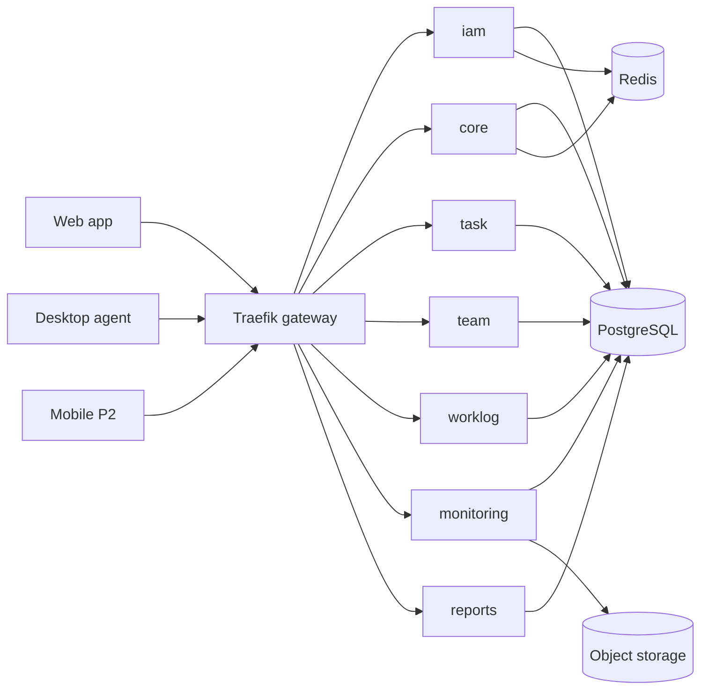

# NeatSprint

**Privacy-honest agile delivery for real teams.**

[](LICENSE)
[](#project-status)
[](docs/README.md)

NeatSprint is a multi-tenant, open-source (AGPLv3) platform for agile task management with
transparent work tracking. It brings planning, a secure desktop agent, and honest monitoring into
one product — and gives employees a real way to see and delete what was captured about them.

> **Project status**: **v1.0.2 released** for the web/backend surface. **M0-M5 complete**
> (M5 27/28; 72-hour health window running), **M3 backend + privacy screens complete**, **M4
> reports/console complete**. Login, RBAC, projects/backlog/sprints, teams, timesheets, encrypted
> monitoring with privacy deletion, notifications, reports, exports and the admin console work end
> to end. The Tauri desktop agent was waived for v1.0.0 under ADR-019 and is the next component.

---

## Why NeatSprint

- **Privacy you can verify** — screenshots are captured only while a timer runs, are visible to you
  first, and can be permanently deleted. Deleted means deleted: the image and any derived AI data
  are destroyed, and managers see only a tombstone.
- **Offline that actually works** — the desktop agent keeps tracking through network loss and syncs
  without duplicates or data loss.
- **Multi-tenant by construction** — tenant isolation and feature-level permissions are enforced
  server-side and tested on every change.
- **Agile without ceremony** — backlog, sprints, board, timesheets, velocity and burndown, with no
  gamified busywork.
- **Open core** — self-host the AGPLv3 code; the commercial cloud adds billing, SLA and compliance.

---

## What Ships

| Component | Description | Technology |
| :--- | :--- | :--- |
| **Web app** | Planning, boards, reports, admin, monitoring review | Next.js 16, TypeScript, Tailwind, shadcn/ui |
| **Desktop agent** | Timer, idle detection, screenshots, offline sync, privacy review tray | Tauri v2, Rust, React, SQLCipher |
| **Mobile app** *(Phase 2)* | Assigned work, manual time, chat, notifications | React Native (Expo) |
| **API gateway** | Single ingress, auth, rate limits, routing | Traefik v3 |
| **Backend services** | Identity, tenancy, tasks, teams, time, monitoring, reports, chat*(P2)*, AI*(P3)* | Python 3.12, FastAPI, PostgreSQL, Redis |

---

## Architecture at a Glance



| Service | Dev port | Responsibility |
| :--- | :--- | :--- |
| Gateway | `8000` | Routing, TLS, rate limits, ForwardAuth |
| IAM | `8001` | Auth, users, roles, permissions, invitations, audit |
| Core | `8002` | Tenants, plans, application modules, settings |
| Task | `8003` | Projects, backlog, sprints, comments |
| Team | `8004` | Teams and membership |
| Worklog | `8005` | Timer, time entries, timesheets |
| Monitoring | `8006` | Devices, screenshots, privacy window, retention |
| Chat *(P2)* | `8007` | Channels, messages, presence |
| Reports | `8008` | Read-model analytics and exports |
| AI *(P3)* | `8009` | RAG assistant, summaries, drafts |
| Web | `3000` | Browser application |

Each service owns its own logical database. Services communicate over HTTP and events; no service
reads another's database. See [`docs/ARCHITECTURE.md`](docs/ARCHITECTURE.md).

---

## Documentation

The authoritative set lives in [`docs/`](docs/README.md). The original architecture input is kept
in [`documents/`](documents) for reference.

| Document | Read it for |
| :--- | :--- |
| [SCOPE](docs/SCOPE.md) | Requirements, boundaries, acceptance criteria |
| [MASTER PLAN](docs/MASTER_PLAN.md) | Phases, gates, risks, progress |
| [DEVELOPMENT PLAN](docs/DEVELOPMENT_PLAN.md) | The executable task backlog |
| [TEST PLAN](docs/TEST_PLAN.md) | Test strategy, suites and cases |
| [ARCHITECTURE](docs/ARCHITECTURE.md) | Services, flows, decisions in context |
| [DATA MODEL](docs/DATA_MODEL.md) | Schemas, indexes, retention |
| [API SPEC](docs/API_SPEC.md) | Conventions and endpoint catalogue |
| [SECURITY](docs/SECURITY.md) | Threat model, RBAC matrix, privacy model |
| [UI/UX](docs/UI_UX_DESIGN.md) | Design system, screens, flows, copy |
| [DEVOPS](docs/DEVOPS.md) | Environments, CI/CD, observability, DR |
| [REPOSITORIES](docs/REPOSITORIES.md) | Repo topology and submodule workflow |
| [DECISIONS](docs/DECISIONS.md) | ADRs |
| [GLOSSARY](docs/GLOSSARY.md) | Shared vocabulary |
| [CONTRIBUTING](docs/CONTRIBUTING.md) | How to work in this codebase |
| [SETUP GUIDE](docs/SETUP_GUIDE.md) | Operator checklist: local setup, Google, GitHub |
| [AGENTS.md](AGENTS.md) | Process guide for AI agents |

---

## Roadmap

| Phase | Theme | State |
| :--- | :--- | :--- |
| **M0** | Foundations: repos, Compose, contracts, CI | Done — 21/24 tasks; outbox + seed moved to M1 |
| **M1** | Identity, tenancy, RBAC | Complete — 34/34 |
| **M2** | Projects, backlog, sprints, teams | Complete - 33/33 |
| **M3** | Time tracking, monitoring, desktop agent | 25/40 - backend + privacy screens live; desktop deferred (ADR-019) |
| **M4** | Reports, dashboards, console polish | Complete - 26/26 |
| **M5** | Hardening, legal, launch (`v1.0.0`) | In progress |
| **P2** | Chat, notifications, mobile, GitHub | Deferred |
| **P3** | AI assistant, enterprise compliance, billing | Deferred |

Milestone detail and checkboxes: [`docs/MASTER_PLAN.md`](docs/MASTER_PLAN.md).

---

## Repository Structure

This repository is the **orchestrator**. Product code lives in independent repositories linked as
git submodules.

```text
neatsprint-platform/
├── AGENTS.md              # AI/agent operating guide
├── docs/                  # authoritative documentation
├── documents/             # original reference architecture (read-only)
├── agent/                 # conversation log
├── infra/                 # gateway config, observability, compose overrides
├── scripts/               # bootstrap, migrate, seed, release
├── services/              # git submodules (see docs/REPOSITORIES.md)
├── docker-compose.yml     # local full stack (created in M0)
└── legal/                 # ToS, privacy, DPA (created in M5)
```

Submodule repositories: `neatsprint-contracts`, `neatsprint-lib`, `neatsprint-apigw`,
`neatsprint-iam`, `neatsprint-core`, `neatsprint-task`, `neatsprint-team`, `neatsprint-worklog`,
`neatsprint-monitoring`, `neatsprint-chat`, `neatsprint-reports`, `neatsprint-ai`,
`neatsprint-web`, `neatsprint-desktop`, `neatsprint-mobile`.

---

## Getting Started

```bash
git clone --recurse-submodules https://github.com/neatsprint/neatsprint-platform.git
cd neatsprint-platform
./scripts/bootstrap.ps1     # Windows PowerShell (or ./scripts/bootstrap.sh)
```

`bootstrap` creates `.env` from `.env.example`, builds and starts the stack, waits for every
service, then seeds the demo tenant. To do it by hand:

```bash
cp .env.example .env
docker compose up -d --build
python scripts/seed.py
```

- Web: <http://localhost:3000>
- API: <http://localhost:8000/api/v1>
- Traefik dashboard: <http://localhost:8089>
- MinIO console: <http://localhost:9001>
- Mailpit (email): <http://localhost:8025>

Sign in with any demo account — password `NeatSprint!2026` for all:

| Email | Role |
| :--- | :--- |
| `owner@acme-labs.com` | Owner |
| `admin@acme-labs.com` | Admin |
| `manager@acme-labs.com` | Manager |
| `lead@acme-labs.com` | Lead |
| `member@acme-labs.com` | Member |
| `viewer@acme-labs.com` | Viewer |

Optional profiles:

```bash
docker compose --profile observability up -d   # Prometheus :9090, Grafana :3001
CLAMAV_HOST=clamav docker compose --profile security up -d clamav
docker compose up -d neatsprint-task neatsprint-monitoring   # pick up CLAMAV_HOST
```

`CLAMAV_HOST` must be set before starting Task and Monitoring. With it set and the scanner down,
uploads fail closed with `503`; see `docs/RUNBOOKS.md`.

To reset local data: `docker compose down -v` (destroys all local volumes).

Full dev/staging start-stop-rebuild lifecycle and profile behaviour:
[`docs/RUNBOOKS.md`](docs/RUNBOOKS.md#environment-lifecycle-dev-and-staging).

### Prerequisites

- Docker Desktop 4.x+ with Compose v2
- Node 22 LTS and npm (web)
- Python 3.12 and uv (services)
- Rust stable + Tauri prerequisites (desktop agent only)

A clean-machine walkthrough is recorded in [`docs/ONBOARDING_DRY_RUN.md`](docs/ONBOARDING_DRY_RUN.md).

---

## Security & Privacy

- Tenant isolation and permission checks are enforced server-side and covered by an automated
  isolation suite.
- Screenshots are encrypted at rest, reviewed by the employee first, and permanently deleted on
  request; blobs are excluded from backups so deletion cannot be undone by a restore.
- Report a vulnerability privately — see [`SECURITY.md`](docs/SECURITY.md) §13, not a public issue.

The full threat model and privacy design are in [`docs/SECURITY.md`](docs/SECURITY.md).

---

## Contributing

Read [`AGENTS.md`](AGENTS.md) for the working process and [`docs/CONTRIBUTING.md`](docs/CONTRIBUTING.md)
for standards. In short:

1. Pick the next unchecked task in `docs/DEVELOPMENT_PLAN.md`.
2. Branch, implement, test, update docs.
3. Open a PR with the checklist; squash-merge to `main`.
4. Bump the submodule pin from the orchestrator.

## Licence

Source code is licensed under the **GNU Affero General Public License v3.0** — see [`LICENSE`](LICENSE).
The hosted service will be governed by separate commercial terms (published before launch).

---

**NeatSprint — plan the work. Prove the work. Respect the person.**
