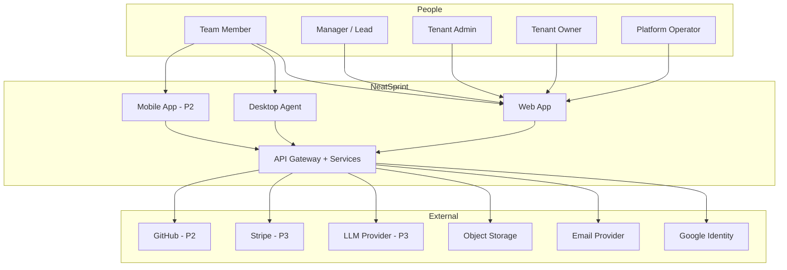
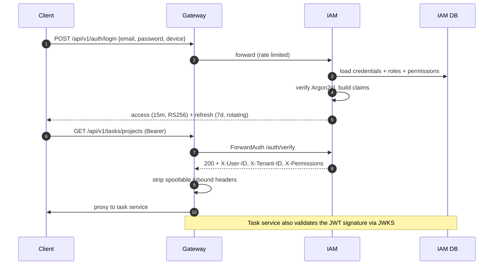
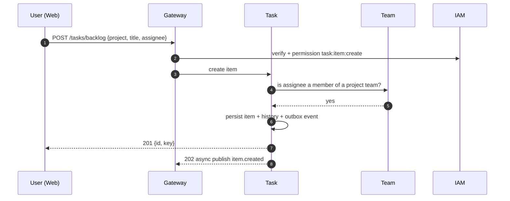
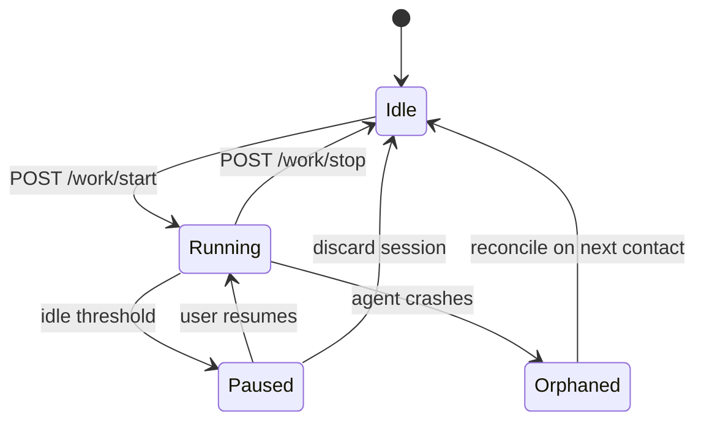
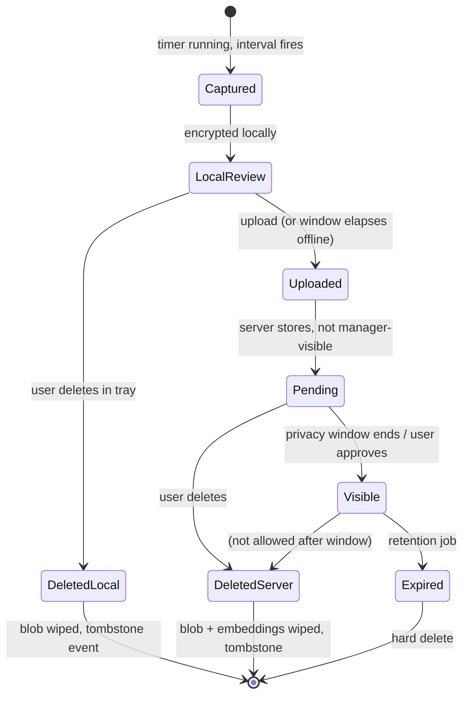
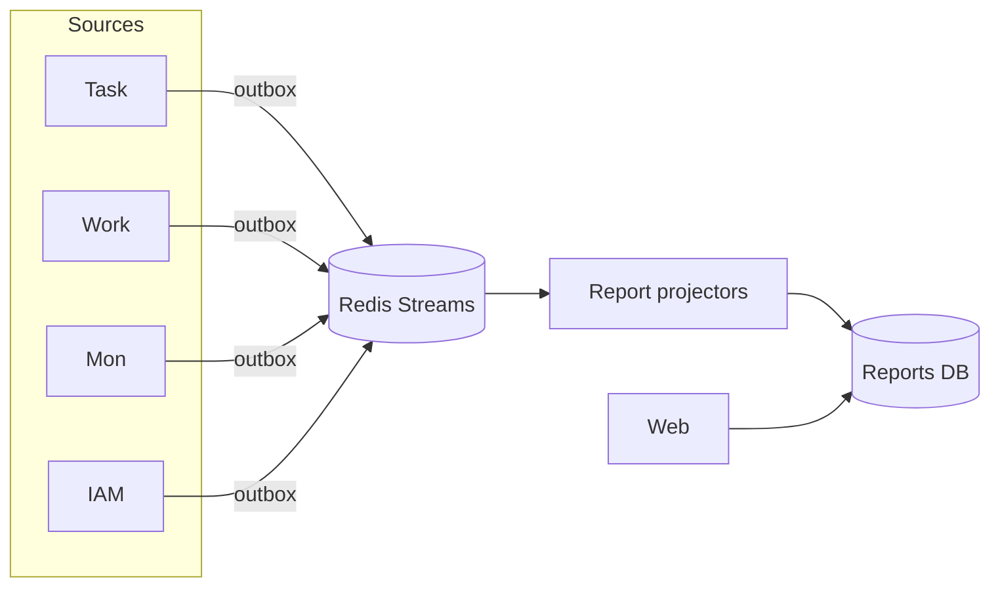
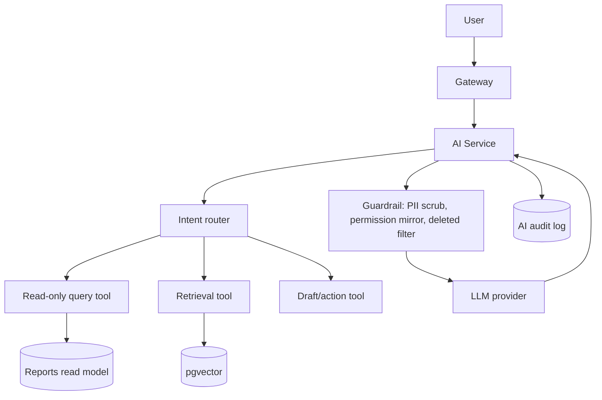

# NeatSprint — System Architecture

> **Status**: Approved v1.0 · **Version**: 1.0 · **Last updated**: 2026-11-21
> **Owner**: Laksiri Fernando · **Author**: OpenCade (AI)
> **Supersedes**: `documents/tech-design.md`, `step1`, `step3`, `step6`, `step7`, `step12–14`, `step19`, `step21`
> **Related**: `DATA_MODEL.md`, `API_SPEC.md`, `SECURITY.md`, `DEVOPS.md`, `DECISIONS.md`

---

## 1. Architectural Summary

NeatSprint is a set of small, independently deployable services behind one API gateway, with
three client applications and a shared contract repository. Each service owns its data; nothing
reaches into another service's database. Events propagate state that other services need to
project.

**Design drivers, in order:**

1. **Tenant isolation** must be verifiable, not aspirational.
2. **Privacy deletion** must be irreversible and auditable.
3. **Offline durability** on the desktop.
4. **Operational simplicity** for a small team.
5. **Extensibility** to additional enterprise applications without redesigning identity/tenancy.

### 1.1 What changed from the reference documents

| Reference claim | Problem | Resolution |
| :--- | :--- | :--- |
| Backend is "Node.js/Go/Rust" in Step 1 but "FastAPI" in tech-design | Contradiction | **Python 3.12 + FastAPI** (ADR-001) |
| Gateway ports 8001–8008 in Step 4 vs 8001–8009 in README | Drift | Canonical port map in §3.2; all containers listen on 8000 internally |
| "Server never sees unencrypted screenshots" (Step 14) yet AI analyses screenshots (Step 21) and managers view them (Step 7) | Impossible combination | **KMS envelope encryption**; server decrypts only for authorised, audited views (ADR-005) |
| Deletion window described locally (Step 8) and server-side (Step 14) | Two conflicting truths | **Server-authoritative privacy window** with client-side review tray (ADR-006) |
| Services "trust injected headers, do not re-verify" (Step 4) but "Zero Trust, services validate JWT" (Step 9) | Contradiction | **Both**: gateway validates, services also validate via JWKS (ADR-007) |
| Reports join read replicas of several databases (Step 19) | Cross-database joins impossible | **Read-model projections** in the reports service (ADR-008) |
| Device binding on CPU serial/MAC (Step 16) | Spoofable, privacy-invasive, brittle | **Device key pair + signed request nonce**, OS keychain (ADR-010) |
| Screenshot E2E encryption while AI reads them | Impossible | Same as ADR-005 |
| Two incompatible permission formats (`TASK_CREATE` vs `task:item:create`) | Drift | One format, lowercase `domain:resource:action` |
| Chat described as DMs in Phase 2 but "one channel per team" in scope | Ambiguity | Team channels only in P2 MVP; DMs later |
| MVP roadmap already ticked `[x]` | Misleading progress | Reset to `[ ]`; progress lives in this plan |

---

## 2. System Context (C4 Level 1)



---

## 3. Container View (C4 Level 2)

### 3.1 Containers

```mermaid
graph TD
    subgraph Clients
        Web[Web - Next.js]
        Desktop[Desktop - Tauri]
        Mobile[Mobile - Expo P2]
    end

    GW[Traefik Gateway]

    subgraph Identity_and_Tenancy
        IAM[iam]
        Core[core]
    end

    subgraph Work
        Task[task]
        Team[team]
        Work[worklog]
        Mon[monitoring]
    end

    subgraph Insight
        Reports[reports]
        Chat[chat P2]
        AI[ai P3]
    end

    subgraph Data
        PG[(PostgreSQL 16)]
        Redis[(Redis 7)]
        S3[(MinIO / S3)]
        KMS[KMS]
    end

    Web --> GW
    Desktop --> GW
    Mobile --> GW
    GW --> IAM & Core & Task & Team & Work & Mon & Reports

    IAM --> PG
    Core --> PG
    Task --> PG
    Team --> PG
    Work --> PG
    Mon --> PG
    Mon --> S3
    Mon --> KMS
    Reports --> PG
    IAM --> Redis
    Core --> Redis
    Task --> Redis
    Mon --> Redis
```

### 3.2 Service catalogue (canonical)

| Service | Repo | Container port | Host (dev) | Path prefix | Owns |
| :--- | :--- | :--- | :--- | :--- | :--- |
| API Gateway | `neatsprint-apigw` | 8080 / 8443 | 8000 | `/api/v1` | — (stateless) |
| IAM | `neatsprint-iam` | 8000 | 8001 | `/api/v1/auth`, `/api/v1/iam` | identity, roles, audit |
| Core | `neatsprint-core` | 8000 | 8002 | `/api/v1/core` | tenants, plans, modules |
| Task | `neatsprint-task` | 8000 | 8003 | `/api/v1/tasks` | projects, items, sprints |
| Team | `neatsprint-team` | 8000 | 8004 | `/api/v1/teams` | teams, membership |
| Worklog | `neatsprint-worklog` | 8000 | 8005 | `/api/v1/work` | sessions, time entries |
| Monitoring | `neatsprint-monitoring` | 8000 | 8006 | `/api/v1/monitor` | devices, screenshots, privacy |
| Chat (P2) | `neatsprint-chat` | 8000 | 8007 | `/api/v1/chat` | channels, messages |
| Reports | `neatsprint-reports` | 8000 | 8008 | `/api/v1/reports` | projections, exports |
| AI (P3) | `neatsprint-ai` | 8000 | 8009 | `/api/v1/ai` | conversations, summaries, embeddings |
| Web | `neatsprint-web` | 3000 | 3000 | `/` | UI |
| Desktop | `neatsprint-desktop` | — | — | — | local agent |
| Mobile (P2) | `neatsprint-mobile` | — | — | — | app |

Infrastructure in dev: PostgreSQL `5432`, Redis `6379`, MinIO `9000/9001`, Mailpit `8025`.
Internal service-to-service calls use `http://neatsprint-<service>:8000`.

### 3.3 Responsibility boundaries

| Service | Does | Does not |
| :--- | :--- | :--- |
| **IAM** | Authentication, tokens, users, roles, permissions, invitations, audit | Know about projects or time |
| **Core** | Tenant lifecycle, plans, module registry, tenant settings | Authenticate users |
| **Task** | Projects, backlog, sprints, item history, comments | Track time or store screenshots |
| **Team** | Teams, membership, project-team mapping | Authorise project actions |
| **Worklog** | Sessions, entries, timesheets, idle segments | Decide task status |
| **Monitoring** | Devices, capture metadata, privacy window, deletion | Decide who may see a team's data (asks IAM/token scope) |
| **Reports** | Projections, aggregation, exports | Mutate source data |
| **Chat (P2)** | Channels, messages, presence | Own team membership |
| **AI (P3)** | Reasoning, retrieval, drafts | Exceed the caller's permissions |

---

## 4. Identity, Tenancy & Authorisation

### 4.1 Tenancy model

- `tenant` is the billing and isolation boundary. Every tenant-owned table carries `tenant_id`.
  **A tenant has many users**; every user logs in and works independently (subject to seat limits).
- `user` is an account that belongs to exactly **one** tenant (ADR-012). Email is globally unique,
  so login is unambiguous; the same person in two workspaces needs two accounts in MVP.
- `team` groups users inside a tenant. `project` can involve multiple teams.
- `application` is global; `tenant_application` enables modules per tenant.

### 4.2 Authentication



**Token claims** (minimum): `iss`, `sub` (user), `tid` (tenant), `sid` (session), `jti`,
`roles`, `scope` (permission strings), `device_id` (when applicable), `exp`, `iat`.

**Refresh tokens** are opaque-or-JWT but always server-tracked, rotated on use, family-revoked on
reuse. Access tokens are never stored in `localStorage` on the web.

### 4.3 Control plane vs data plane

| Concern | Control plane | Data plane |
| :--- | :--- | :--- |
| Who may call | Gateway (signature, expiry, coarse permission) | Service (JWKS + permission + resource scope) |
| Which tenant | Token `tid`; header must match | `tenant_id` filter on every repository call |
| Which records | — | Project/team membership resolution in the owning service |

The gateway is an optimisation and a single choke point, **not** the security boundary.

### 4.4 Permission evaluation

```text
allow = permission_in_token(required)
        AND tenant_matches(resource.tenant_id, token.tid)
        AND resource_scope_allows(actor, resource)   # own / team / tenant
        AND module_enabled(tenant, required_module)
```

`resource_scope_allows` is implemented per domain (e.g. project membership in Task, team
membership in Team/Worklog). Deny by default; deny wins over allow.

### 4.5 Extension model for future applications

A new application (e.g. APS, ERP module) must be addable without touching IAM or Core:

1. Register the application and its features in Core.
2. Declare new permission strings under a new domain prefix.
3. Ship a new service and gateway route; reuse the token, tenant context and audit.
4. Add the module to plan definitions and the tenant application list.

---

## 5. Work Management Flow



**Rules enforced in Task:**

- Item belongs to one project; project key unique per tenant; item sequence per project.
- One assignee maximum; assignee must be an eligible member.
- Ranking uses lexicographic fractional keys to avoid full renumbering.
- Every transition writes `item_history` with actor and reason.

---

## 6. Time Tracking & Monitoring Flow

### 6.1 Timer lifecycle



Server is authoritative: a session row exists on the server, and the desktop agent reconciles on
reconnect. Duration is computed from **monotonic** client elapsed time, cross-checked against
server wall clock, with anomalies flagged rather than silently accepted.

### 6.2 Screenshot lifecycle (privacy-critical)



Canonical rules:

1. Capture only while a timer is running and the device is not suspended.
2. Encrypt locally at capture. Upload as `pending`.
3. While `pending`, only the owner can see it. Managers get `403 not_yet_visible`.
4. Owner may delete at any time while pending. Deletion destroys the blob and any derived
   embedding, and writes an audit row.
5. At window end, the server transitions remaining `pending` rows to `visible`.
6. `visible` rows are manager-readable (audited) until retention expiry.
7. Tombstones are permanent metadata: id, user, captured_at, deleted_at, actor, reason.
   No path, no thumbnail, no derived text.

See `SECURITY.md` §6 for the full control set and `TEST_PLAN.md` TC-MON-* for verification.

---

## 7. Reporting Architecture

Reports do not query other services' databases. They consume events into a **read model**.



- Projectors are idempotent and replayable; a full rebuild is a supported operation.
- Backfill endpoint walks source APIs for historical data on first deploy.
- Exports are asynchronous jobs producing CSV/PDF stored in object storage with signed URLs.
- Aggregation mode suppresses rows when a cohort is below the configured threshold.

---

## 8. Chat & Mobile (Phase 2, designed now)

- Chat service owns channels and messages; membership is checked against Team on every channel
  access (cached briefly).
- WebSocket gateway is part of the chat service; JWT in the handshake, short-lived ticket.
- Fan-out uses Redis Pub/Sub per channel; presence uses TTL keys from desktop heartbeats.
- Mobile is an Expo app consuming the same API; offline queue mirrors the desktop queue design.

These are documented so that MVP decisions (IDs, tenant scoping, event names) remain compatible.

---

## 9. AI Architecture (Phase 3, designed now)



Hard constraints:

- The AI acts **on behalf of** the caller using the caller's token; effective permissions are the
  intersection of the AI service account and the caller.
- Deleted screenshots and their embeddings are never retrieved.
- Any write is a **draft** until the user confirms in the UI.
- Every prompt, tool call, source id and response is audit-logged; PII is scrubbed before leaving
  the platform.

---

## 10. Event Model

Events are facts in past tense, versioned, and carry `event_id`, `occurred_at`, `tenant_id`,
`actor_id`, `aggregate_id`, `version`.

| Event | Producer | Consumers |
| :--- | :--- | :--- |
| `tenant.created`, `tenant.settings_changed` | Core | Reports, IAM cache |
| `module.toggled` | Core | Gateway cache, services |
| `user.created`, `user.deactivated`, `role.changed` | IAM | Task, Team, Worklog, Reports, Monitoring |
| `team.created`, `team.member_added/removed` | Team | Task, Reports, Chat |
| `project.created/archived` | Task | Reports, Worklog |
| `item.created/updated/transitioned/assigned` | Task | Reports, notifications |
| `sprint.started/completed` | Task | Reports, notifications |
| `work.session_started/stopped`, `time_entry.recorded` | Worklog | Reports |
| `screenshot.captured/deleted/available/expired` | Monitoring | Reports, AI (purge on delete) |
| `device.registered/revoked/wiped` | Monitoring | Reports, notifications |
| `export.requested/completed` | Reports | Notifications |

Delivery: transactional outbox → Redis Streams → consumer groups with idempotency keys and a dead
letter stream. No service publishes to a stream without an outbox row in the same transaction.

---

## 11. Data Architecture

- **Database per service** (logical database on one cluster for MVP; separate clusters later).
- **UUIDv7** primary keys everywhere; client-generated for offline-capable entities.
- **Audit columns** on all business tables: `created_at`, `updated_at`, `created_by`, `updated_by`.
- **Soft delete** via `deleted_at` for user-facing entities; hard delete for privacy-sensitive blobs.
- **Partitioning** for `time_entries`, `screenshots`, `activity_heartbeats`, `audit_log`.
- **No foreign keys across service boundaries** — store IDs and validate via API.

Details, DDL notes and indexes: `DATA_MODEL.md`.

---

## 12. Caching

| Cache | Key | TTL | Invalidation |
| :--- | :--- | :--- | :--- |
| Permissions | `perm:{tenant}:{role}` | 60 min | `role.changed` event |
| Tenant settings | `tenant:cfg:{id}` | 15 min | `tenant.settings_changed` |
| Module enablement | `tenant:mod:{id}` | 15 min | `module.toggled` |
| JWKS | `jwks:{kid}` | 24 h or rotation | key rotation event |
| Project access | `acl:proj:{project}:{user}` | 5 min | team/item access change event |
| Report results | `rpt:{tenant}:{hash}` | 10 min | source event for tenant |

Cache failures degrade to database reads where safe; auth decisions **fail closed** (ADR-007).

---

## 13. Deployment Topology

| Environment | Topology |
| :--- | :--- |
| Local | Docker Compose: 15 containers + observability profile |
| CI | Ephemeral containers per test job; images built and scanned |
| Staging | Single-node Kubernetes (or compose on a VM for earliest stages) + managed Postgres |
| Production MVP | Managed Postgres (PITR), managed Redis, S3, 2 replicas per stateless service, Traefik ingress |

Stateless services: no local disk except temp files; all state in Postgres/Redis/S3. Migrations run
as a pre-deploy job per service, forward-only.

---

## 14. Failure Modes & Behaviour

| Failure | Expected behaviour |
| :--- | :--- |
| IAM unavailable | API returns 503 (fail closed); existing sessions short-circuit? No — deny. Desktop keeps capturing locally and retries. |
| Redis unavailable | Permission cache bypassed to DB; rate limiting degrades to per-instance; events buffer via outbox (no loss). |
| Object storage unavailable | Uploads return 503 with retry-after; agent keeps encrypted local queue. |
| Reports down | Core product unaffected; report screens show a service error state. |
| Postgres primary failover | Services reconnect with backoff; in-flight writes fail with retryable 503. |
| Desktop offline | Full local capture; sync resumes with backoff; no duplicates. |
| Clock manipulation | Monotonic durations + server clamping + anomaly audit. |
| Device revoked | Agent clears tokens on next contact; UI locks. |

---

## 15. Architecture Constraints (do not violate)

1. No service reads another service's database, even read-only.
2. No cross-tenant query path exists, including admin and reporting paths.
3. No screenshot, thumbnail or derived text survives deletion.
4. No AI feature may exceed the caller's permissions.
5. No client stores access tokens in `localStorage`.
6. No synchronous call chain deeper than three services for a user request.
7. No schema change without a migration and a compatibility note.

---

## 16. Runtime & Language Boundaries

| Layer | Language | Rule |
| :--- | :--- | :--- |
| Domain services | Python / FastAPI | I/O-bound orchestration, validation, SQL, events |
| Web UI + BFF | TypeScript / Next.js | Session cookies, rendering; **never** a service runtime |
| Desktop agent | Rust + React | Capture, crypto, local DB, offline queue |
| Media / hot paths | Rust *(conditional)* | Only when a benchmark proves Python/libvips is insufficient |
| Reports | Python | DB-bound aggregation, no Rust rewrite |
| AI | Python | Provider calls, retrieval, guardrails |

Decision rule for Rust (ADR-018): profile first; the work must be CPU-bound, the interface narrow,
and the component either high-volume or resident on a user device. Exhaust `libvips`, PostgreSQL
aggregation and worker parallelism before adding a Rust build to CI.

---

## 17. Resolved Architecture Items (M0–M5)

| Item | Needed by | Resolution |
| :--- | :--- | :--- |
| Confirm FastAPI stack (ADR-001) | M0 | Confirmed (Python 3.12 + FastAPI) |
| Confirm KMS envelope vs E2E (ADR-005) | M3 | Confirmed (KMS envelope encryption, AES-256-GCM) |
| Choose KMS provider for MVP (local file vs cloud KMS) | M3 | Local/env master key in MVP; AWS KMS / Vault adapter for production |
| Decide PDF renderer (headless Chromium vs WeasyPrint) | M4 | ReportLab direct PDF generation chosen in M4 to keep container image small |
| Confirm desktop platform order | M3 | Tauri v2 + Rust retained; desktop build deferred under ADR-019 |

---

## 18. Required Improvements (Post-v1.0.2 Review)

- [ ] **IMP-ARC-01 (Event completeness for soft deletes & updates)**: `neatsprint-task` does not yet
  emit `item.deleted` when soft-deleting a backlog item, so `neatsprint-reports` retains deleted
  items in `report_item_facts`. Add `item.deleted` to the event model (§10), emit it in Task, and
  delete the corresponding fact in Reports (`IMP-T01`).
- [ ] **IMP-ARC-02 (Distributed caching in Redis vs in-process dicts)**: §12 specifies Redis-backed
  caches (`rpt:{tenant}:{hash}`, `acl:proj:{project}:{user}`), whereas `neatsprint-reports`,
  `neatsprint-task` and `neatsprint-monitoring` currently use per-process Python dictionaries with
  30–60 s TTLs. Migrate those caches to Redis so multi-replica deployments share invalidations and
  avoid cache stampedes (`IMP-T05`).
- [ ] **IMP-ARC-03 (Gateway RFC 7807 error formatting)**: When an upstream service is down, Traefik
  returns plain-text `502 Bad Gateway` (`CHAOS_TEST.md`). Add a Traefik custom error middleware so
  all 502/503/504 edge responses conform to the RFC 7807 JSON contract (`IMP-T06`).
- [ ] **IMP-ARC-04 (Dead-letter stream & consumer lag metrics)**: Outbox and Redis Streams consumers
  retry in place; add explicit dead-letter stream routing after max attempts and export
  `outbox_pending` / `stream_consumer_lag` Prometheus gauges (§10, `DEVOPS.md` §5.2).

---

**End of Architecture**
