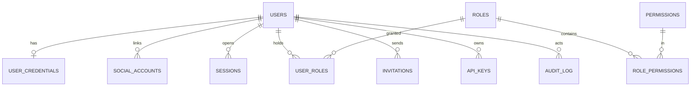
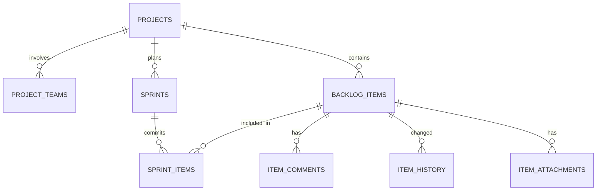

# NeatSprint — Data Model

> **Status**: Approved v1.0 · **Version**: 1.0 · **Last updated**: 2026-11-21
> **Owner**: Laksiri Fernando · **Author**: OpenCade (AI)
> **Supersedes**: `documents/step6-er-diagrams.md`, `documents/step7-neatsprint-database-schemas.md`
> **Related**: `ARCHITECTURE.md` §11, `SECURITY.md` §4, `API_SPEC.md`

---

## 1. Conventions

| Rule | Detail |
| :--- | :--- |
| Engine | PostgreSQL 16 |
| Isolation | One **logical database per service**: `db_iam`, `db_core`, `db_task`, `db_team`, `db_worklog`, `db_monitoring`, `db_reports`, `db_chat`, `db_ai` |
| Primary keys | `uuid` **UUIDv7** named `id` |
| Naming | `snake_case`, singular table names are **not** used — tables are plural (`users`, `backlog_items`) |
| Tenant scope | `tenant_id uuid NOT NULL` on every tenant-owned table, indexed |
| Audit columns | `created_at timestamptz NOT NULL DEFAULT now()`, `updated_at timestamptz NOT NULL`, `created_by uuid`, `updated_by uuid` |
| Soft delete | `deleted_at timestamptz NULL` (user-facing entities only) |
| Cross-service refs | Store the UUID, **no FK**, plus a comment naming the owner service |
| Timestamps | `timestamptz`, always UTC |
| Money | `numeric(14,2)` with currency code; not used in MVP |
| Enums | Native Postgres enums are avoided; use `varchar` + `check` constraint + app enum, so migrations stay simple |
| JSON | `jsonb` for flexible payloads only (settings, metadata, audit diffs) |
| Indexes | Every FK/logical ref used in filters; every tenant-scoped list uses `(tenant_id, <sort>)` |
| Migrations | Alembic, forward-only, one migration per logical change, reviewed |
| Text search | `pg_trgm` for item title search in MVP; `tsvector` optional later |

### 1.1 Standard column block

```sql
id          uuid PRIMARY KEY,
tenant_id   uuid NOT NULL,
-- ... domain columns ...
created_at  timestamptz NOT NULL DEFAULT now(),
created_by  uuid,
updated_at  timestamptz NOT NULL DEFAULT now(),
updated_by  uuid,
deleted_at  timestamptz
```

---

## 2. Identity Service — `db_iam`

### 2.1 Tables



| Table | Key columns | Notes |
| :--- | :--- | :--- |
| `users` | `tenant_id`, `email citext`, `full_name`, `avatar_url`, `job_title`, `timezone`, `locale`, `status` | **Globally unique `email`** (ADR-012) — one account per tenant; status: `INVITED`, `ACTIVE`, `DISABLED` |
| `user_credentials` | `user_id` PK/FK, `password_hash`, `password_updated_at`, `must_change` | Argon2id; 1:1 |
| `social_accounts` | `user_id`, `provider` (`google`, `github`, `microsoft`), `provider_subject`, `email_at_provider` | `UNIQUE (provider, provider_subject)` |
| `sessions` | `user_id`, `device_id`, `refresh_token_hash`, `family_id`, `ip`, `user_agent`, `expires_at`, `revoked_at`, `revoke_reason` | rotation + reuse detection |
| `invitations` | `tenant_id`, `email`, `token_hash`, `invited_by`, `role_ids uuid[]`, `team_ids uuid[]`, `expires_at`, `accepted_at`, `revoked_at` | single-use; resend reuses row with new token |
| `roles` | `tenant_id`, `code`, `name`, `description`, `is_system`, `base_role_code` | system roles: `OWNER/ADMIN/MANAGER/LEAD/MEMBER/VIEWER` |
| `permissions` | `code`, `domain`, `resource`, `action`, `description` | global catalogue, not tenant-scoped |
| `role_permissions` | `role_id`, `permission_code` | PK pair |
| `user_roles` | `user_id`, `role_id`, `assigned_by`, `assigned_at` | PK pair |
| `api_keys` | `tenant_id`, `name`, `key_hash`, `prefix`, `scopes text[]`, `last_used_at`, `expires_at`, `revoked_at` | Phase 2 public API |
| `audit_log` | `tenant_id`, `actor_id`, `actor_type`, `action`, `target_type`, `target_id`, `before jsonb`, `after jsonb`, `diff_hash`, `ip`, `user_agent`, `request_id` | append-only, partitioned monthly |

### 2.2 Constraints & indexes

```sql
-- users: email is globally unique so login is unambiguous (ADR-012)
CREATE UNIQUE INDEX ux_users_email ON users (email) WHERE deleted_at IS NULL;
CREATE INDEX ix_users_tenant_status ON users (tenant_id, status);

-- sessions
CREATE UNIQUE INDEX ux_sessions_refresh_hash ON sessions (refresh_token_hash);
CREATE INDEX ix_sessions_user_active ON sessions (user_id) WHERE revoked_at IS NULL;

-- roles
CREATE UNIQUE INDEX ux_roles_tenant_code ON roles (tenant_id, code);

-- invitations
CREATE UNIQUE INDEX ux_invitations_token ON invitations (token_hash);
CREATE INDEX ix_invitations_tenant_pending ON invitations (tenant_id, expires_at)
  WHERE accepted_at IS NULL AND revoked_at IS NULL;

-- audit append-only
CREATE OR REPLACE FUNCTION forbid_audit_mutation() RETURNS trigger AS $$
BEGIN RAISE EXCEPTION 'audit_log is append-only'; END $$ LANGUAGE plpgsql;
CREATE TRIGGER trg_audit_no_update BEFORE UPDATE OR DELETE ON audit_log
  FOR EACH ROW EXECUTE FUNCTION forbid_audit_mutation();
```

`email` uses the `citext` extension (case-insensitive).

---

## 3. Core Platform — `db_core`

| Table | Key columns | Notes |
| :--- | :--- | :--- |
| `plans` | `code`, `name`, `max_users`, `max_projects`, `screenshot_retention_days`, `features jsonb` | `FREE`, `TEAM`, `BUSINESS`, `ENTERPRISE` |
| `tenants` | `name`, `slug`, `plan_code`, `status`, `trial_ends_at`, `closed_at` | `UNIQUE (slug)`; status `TRIAL/ACTIVE/SUSPENDED/CLOSED` |
| `tenant_settings` | `tenant_id` PK, `timezone`, `week_start`, `locale`, `screenshot_interval_min`, `screenshot_interval_max`, `privacy_window_hours`, `retention_days`, `aggregation_threshold`, `domain_auto_join` | 1:1 with tenant |
| `applications` | `code`, `name`, `description`, `is_global` | `TASK_MGMT`, `MONITORING`, `REPORTS`, `CHAT`, `AI_ASSISTANT` |
| `application_features` | `application_code`, `feature_code`, `name` | catalogue |
| `tenant_applications` | `tenant_id`, `application_code`, `enabled`, `enabled_at`, `disabled_at` | PK `(tenant_id, application_code)` |

Indexes: `ix_tenants_status`, `ux_tenant_apps_pk` (composite PK).

---

## 4. Task Service — `db_task`



| Table | Key columns | Notes |
| :--- | :--- | :--- |
| `projects` | `tenant_id`, `key`, `name`, `description`, `status`, `start_date`, `end_date`, `created_by` | `UNIQUE (tenant_id, key)`; key `[A-Z][A-Z0-9]{1,9}` |
| `project_teams` | `project_id`, `team_id` | logical ref to Team service |
| `backlog_items` | `tenant_id`, `project_id`, `key`, `sequence int`, `type`, `title`, `description`, `status`, `priority`, `estimate_points numeric(6,2)`, `assignee_id`, `sprint_id`, `rank text`, `due_date`, `reporter_id`, `labels text[]`, `completed_at` | `UNIQUE (project_id, sequence)`; `UNIQUE (project_id, key)` |
| `item_comments` | `tenant_id`, `item_id`, `author_id`, `body`, `edited_at`, `mentioned_user_ids uuid[]` | soft delete |
| `item_history` | `item_id`, `actor_id`, `field`, `from_value`, `to_value`, `reason`, `created_at` | append-only by convention |
| `item_attachments` | `tenant_id`, `item_id`, `file_name`, `content_type`, `size_bytes`, `storage_key`, `checksum`, `uploaded_by` | storage in object store |
| `sprints` | `tenant_id`, `project_id`, `name`, `goal`, `state`, `start_date`, `end_date`, `started_at`, `completed_at`, `snapshot_points numeric`, `snapshot_hours numeric` | partial unique: one `ACTIVE` per project |
| `sprint_items` | `sprint_id`, `item_id`, `committed_points`, `added_at`, `removed_at` | history of scope changes |

### 4.1 Example DDL

```sql
CREATE TABLE backlog_items (
  id               uuid PRIMARY KEY,
  tenant_id        uuid NOT NULL,
  project_id       uuid NOT NULL REFERENCES projects(id),
  key              text NOT NULL,
  sequence         integer NOT NULL,
  type             varchar(16) NOT NULL CHECK (type IN ('TASK','STORY','BUG','SUGGESTION')),
  title            text NOT NULL CHECK (length(title) BETWEEN 1 AND 240),
  description      text,
  status           varchar(16) NOT NULL DEFAULT 'TODO'
                     CHECK (status IN ('TODO','IN_PROGRESS','IN_REVIEW','DONE','BLOCKED')),
  priority         varchar(8)  NOT NULL DEFAULT 'MEDIUM'
                     CHECK (priority IN ('LOW','MEDIUM','HIGH','URGENT')),
  estimate_points  numeric(6,2) CHECK (estimate_points IS NULL OR estimate_points >= 0),
  assignee_id      uuid,            -- logical ref: IAM.users
  sprint_id        uuid REFERENCES sprints(id),
  rank             text NOT NULL,   -- lexicographic ordering key
  due_date         date,
  reporter_id      uuid NOT NULL,
  labels           text[] NOT NULL DEFAULT '{}',
  completed_at     timestamptz,
  created_at       timestamptz NOT NULL DEFAULT now(),
  created_by       uuid,
  updated_at       timestamptz NOT NULL DEFAULT now(),
  updated_by       uuid,
  deleted_at       timestamptz,
  CONSTRAINT ux_item_project_sequence UNIQUE (project_id, sequence),
  CONSTRAINT ux_item_project_key UNIQUE (project_id, key)
);

CREATE INDEX ix_items_board ON backlog_items (tenant_id, project_id, sprint_id, status, rank)
  WHERE deleted_at IS NULL;
CREATE INDEX ix_items_assignee ON backlog_items (tenant_id, assignee_id)
  WHERE deleted_at IS NULL AND status <> 'DONE';
CREATE INDEX ix_items_title_trgm ON backlog_items USING gin (title gin_trgm_ops);

CREATE UNIQUE INDEX ux_one_active_sprint ON sprints (project_id)
  WHERE state = 'ACTIVE';
```

**Item key** is generated as `project.key || '-' || sequence`; sequence allocation uses an
`UPDATE projects SET next_item_sequence = next_item_sequence + 1 RETURNING` inside the same
transaction to stay concurrency-safe.

---

## 5. Team Service — `db_team`

| Table | Key columns | Notes |
| :--- | :--- | :--- |
| `teams` | `tenant_id`, `name`, `description`, `lead_id`, `is_archived` | `UNIQUE (tenant_id, name)` |
| `team_members` | `team_id`, `user_id`, `role_in_team` (`LEAD`/`MEMBER`), `joined_at` | PK `(team_id, user_id)` |

Project-team mapping is owned by Task (`project_teams`) to avoid a bidirectional dependency; Team
emits membership events which Task uses to invalidate access caches.

```sql
CREATE UNIQUE INDEX ux_team_member ON team_members (team_id, user_id);
CREATE INDEX ix_team_members_user ON team_members (user_id);
```

---

## 6. Worklog Service — `db_worklog`

| Table | Key columns | Notes |
| :--- | :--- | :--- |
| `work_sessions` | `tenant_id`, `user_id`, `item_id`, `device_id`, `state`, `started_at`, `ended_at`, `last_heartbeat_at`, `monotonic_elapsed_seconds`, `client_clock_skew_ms`, `comment` | one open session per user (partial unique) |
| `time_entries` | `tenant_id`, `session_id`, `user_id`, `item_id`, `project_id`, `started_at`, `ended_at`, `duration_seconds`, `source` (`TIMER`/`MANUAL`/`IMPORT`), `comment`, `client_id`, `sync_status` | partitioned by month on `started_at` |
| `idle_segments` | `session_id`, `started_at`, `ended_at`, `idle_seconds`, `resolution` (`ACCEPTED`/`DISCARDED`/`TRUNCATED`) | feeds idle reporting |

```sql
CREATE UNIQUE INDEX ux_open_session_per_user ON work_sessions (tenant_id, user_id)
  WHERE state IN ('RUNNING','PAUSED');
CREATE UNIQUE INDEX ux_time_entry_client ON time_entries (tenant_id, client_id);
```

`client_id` is the client-generated UUIDv7 — the idempotency key for offline sync.
`time_entries` is declaratively partitioned monthly; a maintenance job pre-creates the next three
partitions.

---

## 7. Monitoring Service — `db_monitoring`

| Table | Key columns | Notes |
| :--- | :--- | :--- |
| `devices` | `tenant_id`, `user_id`, `name`, `platform`, `public_key`, `fingerprint_hash`, `status`, `last_seen_at`, `revoked_at`, `wipe_requested_at` | key pair, not hardware serials |
| `monitoring_sessions` | `tenant_id`, `user_id`, `work_session_id`, `device_id`, `started_at`, `ended_at`, `state` | mirrors the work session |
| `screenshots` | `tenant_id`, `session_id`, `user_id`, `device_id`, `captured_at`, `storage_key`, `kms_key_id`, `content_hash`, `size_bytes`, `width`, `height`, `display_index`, `state`, `visible_after`, `deleted_by_user`, `deleted_at`, `deleted_by`, `retention_expires_at` | partitioned weekly on `captured_at` |
| `activity_heartbeats` | `tenant_id`, `session_id`, `user_id`, `recorded_at`, `active_seconds`, `idle_seconds`, `device_state` | no content, aggregate only |
| `deletion_audit` | `screenshot_id`, `tenant_id`, `user_id`, `deleted_at`, `request_source` (`AGENT`/`WEB`), `blob_confirmed_deleted`, `embedding_confirmed_deleted` | pairs with IAM audit |

```sql
CREATE INDEX ix_shots_owner_pending ON screenshots (tenant_id, user_id, state, captured_at DESC);
CREATE INDEX ix_shots_manager ON screenshots (tenant_id, state, visible_after, captured_at DESC);
CREATE UNIQUE INDEX ux_shots_hash_per_session ON screenshots (session_id, content_hash);

-- Tombstone invariant: a deleted screenshot never has a storage key
ALTER TABLE screenshots ADD CONSTRAINT ck_deleted_has_no_blob
  CHECK (deleted_by_user = false OR storage_key IS NULL);
```

States: `PENDING`, `VISIBLE`, `DELETED`, `EXPIRED`. `DELETED`/`EXPIRED` keep the row as a
tombstone until retention policy removes it (tombstones survive longer than blobs and are the
audit trail).

---

## 8. Reports Service — `db_reports`

Read model only; no source-of-truth tables.

| Table | Key columns | Purpose |
| :--- | :--- | :--- |
| `report_time_facts` | `tenant_id`, `date`, `user_id`, `team_id`, `project_id`, `item_id`, `source`, `seconds`, `entry_count` | additive time facts |
| `report_item_facts` | `tenant_id`, `date`, `project_id`, `sprint_id`, `status_from`, `status_to`, `count`, `points` | completion/flow |
| `report_sprint_snapshots` | `tenant_id`, `sprint_id`, `date`, `scope_points`, `remaining_points`, `completed_points`, `scope_items` | burndown/velocity |
| `report_monitor_facts` | `tenant_id`, `date`, `user_id`, `team_id`, `session_count`, `active_seconds`, `idle_seconds`, `captures`, `deletions` | monitoring summary |
| `projection_checkpoints` | `stream`, `consumer`, `last_event_id`, `updated_at` | replay/lag |
| `export_jobs` | `tenant_id`, `type`, `format`, `filters jsonb`, `state`, `storage_key`, `expires_at`, `error` | exports |

Indexes are `(tenant_id, date)` plus the primary filter dimension. Enough to serve dashboards;
report queries never touch operational databases.

---

## 9. Chat Service — `db_chat` (Phase 2)

| Table | Key columns |
| :--- | :--- |
| `chat_channels` | `tenant_id`, `team_id`, `project_id`, `name`, `type` (`TEAM`/`PROJECT`) |
| `chat_messages` | `tenant_id`, `channel_id`, `author_id`, `body`, `mentions uuid[]`, `edited_at`, `deleted_at`, `client_id` |
| `chat_reads` | `channel_id`, `user_id`, `last_read_message_id`, `updated_at` |

Partition `chat_messages` by hash on `channel_id` once volume warrants.

---

## 10. AI Service — `db_ai` (Phase 3)

| Table | Key columns |
| :--- | :--- |
| `ai_conversations` | `tenant_id`, `user_id`, `title`, `created_at` |
| `ai_messages` | `conversation_id`, `role` (`USER`/`ASSISTANT`/`TOOL`), `content`, `tool_calls jsonb`, `tokens_in`, `tokens_out` |
| `ai_summaries` | `tenant_id`, `subject_type`, `subject_id`, `period_start`, `period_end`, `summary`, `model`, `created_at` |
| `ai_documents` | `tenant_id`, `source_type`, `source_id`, `content`, `content_hash`, `deleted_at` |
| `ai_embeddings` | `tenant_id`, `document_id`, `embedding vector(1536)`, `model` | `pgvector`; cascade delete with document |
| `ai_audit_log` | `tenant_id`, `user_id`, `prompt`, `tool_calls jsonb`, `source_refs jsonb`, `response`, `model`, `tokens`, `latency_ms`, `created_at` |

Deletion rule: when a source is deleted (screenshot, item, comment), delete `ai_documents` and
`ai_embeddings` rows in the same job that removes the source; the AI must never cite a dead id.

---

## 11. Cross-Service Reference Map

| From (table.column) | To (service.table) | Validated by |
| :--- | :--- | :--- |
| Task `backlog_items.assignee_id` | IAM `users.id` | IAM users API (batch) + team eligibility via Team API |
| Task `project_teams.team_id` | Team `teams.id` | Team API |
| Team `team_members.user_id` | IAM `users.id` | IAM users API |
| Worklog `time_entries.item_id` | Task `backlog_items.id` | Task API (existence + project) |
| Monitoring `screenshots.session_id` | Monitoring `monitoring_sessions.id` | local FK |
| Monitoring `monitoring_sessions.work_session_id` | Worklog `work_sessions.id` | Worklog API |
| Reports facts `user_id`/`item_id` | IAM / Task | event payload validation |
| Chat `chat_channels.team_id` | Team `teams.id` | Team API |

Validation is **eventual** for historical rows and **immediate** for new writes where a user is
acting.

---

## 12. Migration Policy

1. One migration per logical change; descriptive name (`0007_add_screenshot_state`).
2. Forward-only. A bad migration is fixed by a new migration, never edited in place after merge.
3. Destructive changes are two-phase: add new column → backfill → switch reads → drop in a later
   release.
4. Every migration must be safe to run while the previous app version is live (expand/contract).
5. Seed data lives in code (`scripts/seed.py`), never in migrations.
6. Large backfills run as jobs, not inside migrations.
7. CI runs migrations from scratch and against a snapshot of staging schema.

---

## 13. Backup & Retention Summary

| Data | Retention | Backup |
| :--- | :--- | :--- |
| Screenshots (blobs) | tenant setting, default 30 days | not backed up (derived evidence, privacy-first) |
| Screenshot tombstones | 1 year (audit) | in DB backup |
| Time entries | 7 years (configurable) | DB backup + monthly archive |
| Audit log | 1 year hot, 7 years archive (enterprise) | monthly cold archive |
| Project/task data | life of tenant + 30 days after closure | DB backup |
| Deleted entities (`deleted_at`) | purged 30 days after soft delete | DB backup |
| AI conversations | 90 days default | DB backup |

Screenshot blobs are deliberately excluded from backups: restoring a deleted image would violate
the privacy promise. This is recorded as a product decision (ADR-006).

---

## 14. Data Quality & Invariants

Enforced in code **and** protected by constraints where possible:

- `deleted_by_user = true ⇒ storage_key IS NULL`.
- `state = 'VISIBLE' ⇒ visible_after <= now()` (checked at transition time).
- Exactly one `ACTIVE` sprint per project.
- At most one open work session per user.
- `backlog_items.sprint_id` belongs to the same `project_id`.
- `time_entries.duration_seconds > 0`.
- `users.email` globally unique and case-insensitive (one account belongs to one tenant).
- `screenshots.captured_at <= now()` and within the session window.
- No `tenant_id` mismatch between a child row and its parent (composite FK where both live in the
  same DB).

---

## 15. Data Volume Assumptions (MVP)

| Table | Rows/year (est.) | Strategy |
| :--- | ---: | :--- |
| `time_entries` | 3–5 M | monthly partitions, aggregate into reports |
| `screenshots` | 2–4 M metadata rows | weekly partitions, blobs in object storage |
| `activity_heartbeats` | 20–40 M | monthly partitions, downsample after 90 days |
| `audit_log` | 5–10 M | monthly partitions, archive after 12 months |
| `backlog_items` | 200 K | standard B-tree |
| `report_*` | aggregates | rebuildable, small |

---

**End of Data Model**
