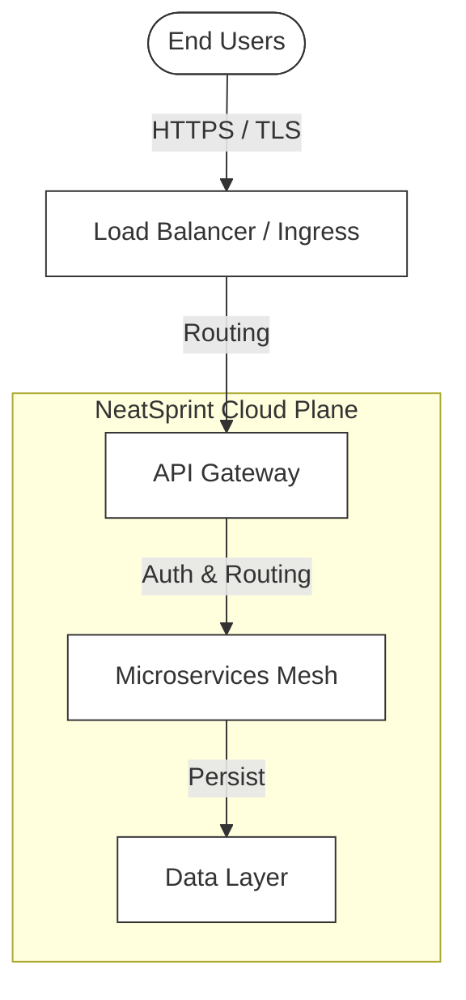
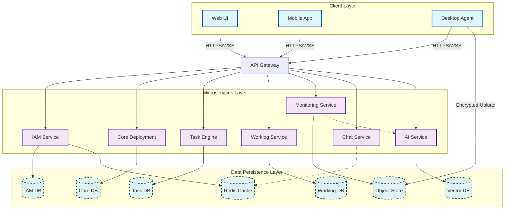

# NeatSprint – Step 1: Full System Architecture

This document provides a comprehensive view of the NeatSprint system architecture, detailing the high-level data flow, logical component layers, and the complete interaction model between services.

---

## 1. High-Level Architecture

The system follows a modern microservices pattern with a centralized API Gateway handling all ingress traffic.

---

## 2. Component Architecture (Logical Layers)

### 2.1. Client Layer

| Component | Technology | Responsibilities |
| :--- | :--- | :--- |
| **Web UI** | React, Vite, TS | Dashboard, Project Management, Reports, Admin Console. |
| **Mobile App** | React Native | Task status updates, Chat, Time logging on-the-go. |
| **Desktop Agent** | Tauri (Rust + React) | **Primary Work Interface**. Time tracking, Offline support, Screenshots, Security/Encryption. |

### 2.2. Gateway Layer

| Component | Responsibility | Key Functions |
| :--- | :--- | :--- |
| **API Gateway** | Entry Point | SSL Termination, JWT Validation, Rate Limiting, CORS. |
| **Load Balancer** | Traffic Dist. | AWS ALB / Nginx Ingress Controller. |

### 2.3. Service Layer (Microservices)

| Service | Focus | Description |
| :--- | :--- | :--- |
| **IAM Service** | Identity | User Auth, SSO, RBAC Policy enforcement, Tenant management. |
| **Core Platform** | Tenants | Organization logic, Billing, Feature flags, Project metadata. |
| **Task Engine** | Project Mgmt | Sprints, Kanbans, Backlogs, Task assignment & workflow. |
| **Worklog Service** | Time Tracking | Time entries, Idle time analysis, Work proof validation. |
| **Monitoring** | Observability | Screenshot ingestion, Deletion window logic, Privacy scrubbing. |
| **AI Assistant** | Intelligence | Summarization, Work pattern analysis, "Ask NeatSprint" bot. |
| **Chat Service** | Collaboration | Real-time team messaging (WebSocket/gRPC). |

### 2.4. Data Layer

| Store Type | Technology | Usage |
| :--- | :--- | :--- |
| **Relational** | PostgreSQL | Primary SoR (System of Record) for all services. |
| **Cache** | Redis | Session store, Rate limiting counters, Real-time pub/sub. |
| **Object Store** | AWS S3 / MinIO | Encrypted screenshots, User avatars, Document attachments. |
| **Vector DB** | Quadrant / Pinecone | Semantic embeddings for AI search & context. |
| **Time Series** | Prometheus | System metrics (CPU, RAM, API latencies). |

---

## 3. Master Architecture Diagram

This diagram visualizes the end-to-end flow from client devices to the persistence layer.

---

## 4. Key Technologies Stack

| Category | Technology |
| :--- | :--- |
| **Backend** | Node.js (TypeScript) / Go / Rust (Performance critical) |
| **Web** | React, TailwindCSS, Vite |
| **Mobile** | React Native (Expo), TypeScript |
| **Desktop** | Tauri, Rust, SQLite (SQLCipher) |
| **Infrastructure** | Kubernetes (EKS), Terraform, Helm |
| **CI/CD** | GitHub Actions, ArgoCD |
| **Observability** | Prometheus, Grafana, Loki, OpenTelemetry |

---

**End of Architecture Overview**