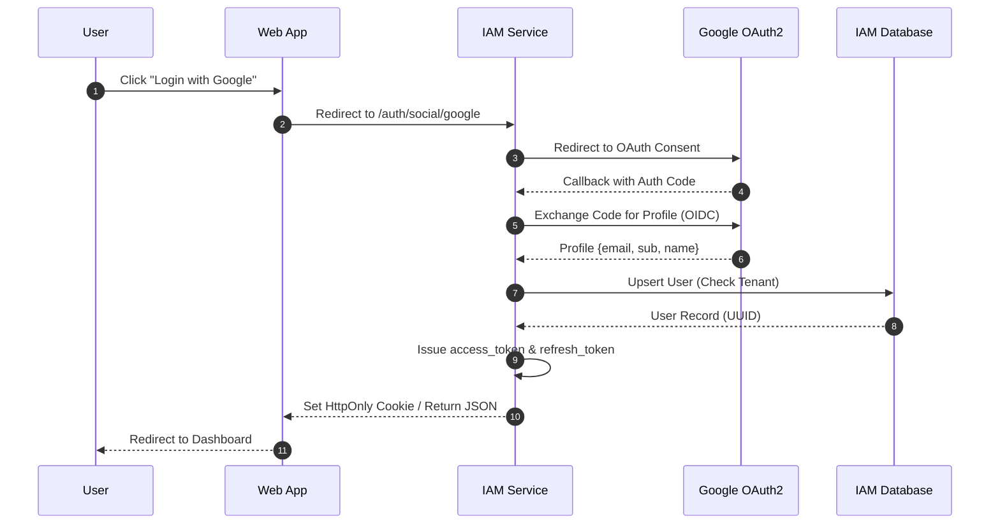
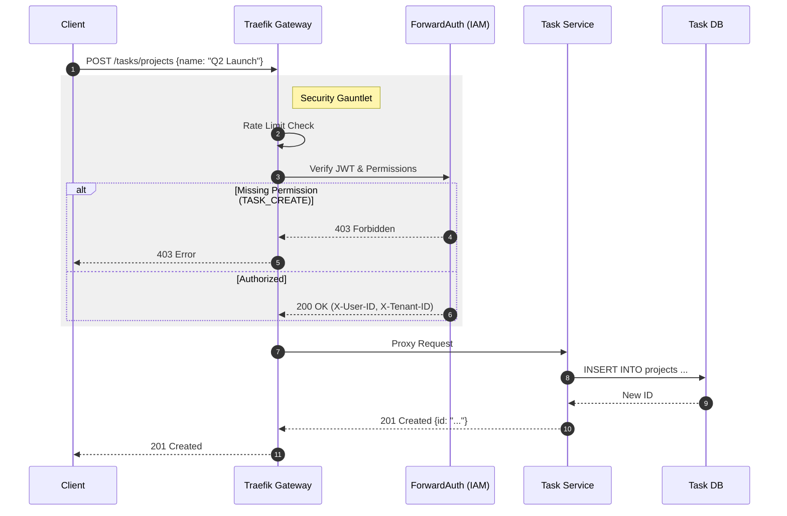
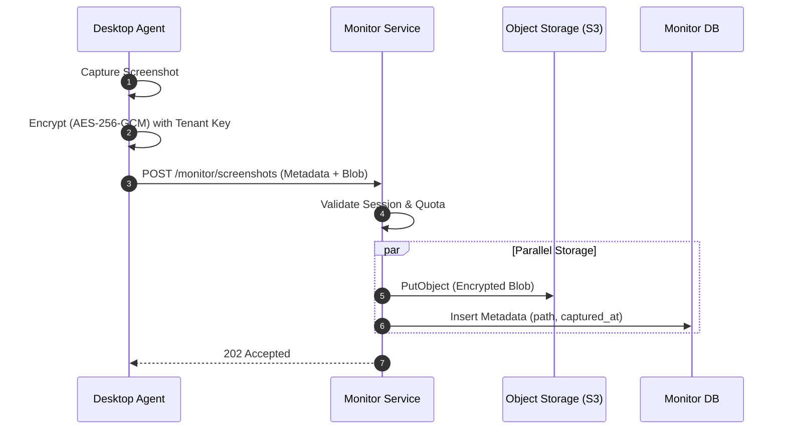
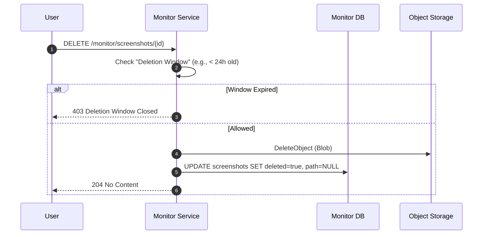

# NeatSprint – Step 14: End-to-End Request Flows

This document visualizes the "Golden Paths" of the system, showing how components interact during critical user journeys.

---

## 1. Social Login Flow (Google)

This flow demonstrates how a user authenticates via a third-party provider and receives a session.

**Security Notes**:
-   **JIT Provisioning**: User is created on-the-fly if the email domain matches a tenant.
-   **Token scope**: Includes `tid` (Tenant ID) and `roles`.

---

## 2. Protected Action: Create Project (RBAC)

This flow shows the "Security Gauntlet" at the API Gateway before a request reaches the service.

---

## 3. High-Security Flow: Screenshot Upload

Demonstrates **Client-Side Encryption** to ensuring zero-knowledge privacy for the server.

**Privacy Guarantee**: The server *never* sees the unencrypted image.

---

## 4. Privacy Feature: "Delete Screenshot"

Shows how we handle "Right to Erasure" while maintaining auditability.

**Result**:
-   **Manager Report**: Shows "Deleted by User" placeholder.
-   **AI Training**: Skipped (Content is gone).

---

**End of Request Flows**
