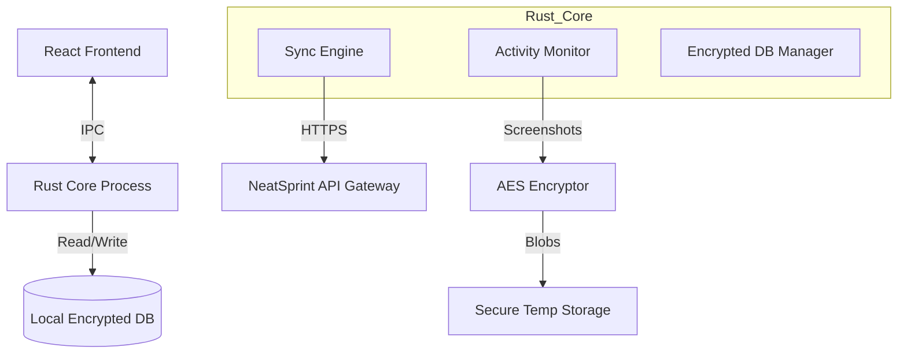

# NeatSprint – Step 15: Desktop App Architecture (Tauri)

The Desktop Agent is the primary work tracking interface. It is built for **performance**, **offline-resilience**, and **privacy**.

---

## 1. Technical Stack

| Component | Technology | Rationale |
| :--- | :--- | :--- |
| **Framework** | **Tauri v2** | 10x smaller binary than Electron, lower RAM usage. |
| **Core Logic** | **Rust** | Memory-safe, high-performance monitoring code. |
| **UI Layer** | **React + TypeScript** | Standard modern web stack (Shared with Web App). |
| **Local DB** | **SQLite (SQLCipher)** | Robust, relational, AES-256 encrypted storage. |

---

## 2. Agent Architecture

### 2.1. Rust Core Modules
1.  **Activity Monitor**: Hooks into OS APIs (Windows/macOS/Linux) to capture screenshots and idle time.
2.  **Sync Engine**: A "Queue-based" system that pushes local changes to the cloud and pulls new tasks.
3.  **Security Enclave**: Manages encryption keys in memory (never writes keys to disk).

---

## 3. Local Data & Encryption

To support **Offline Mode** and **Privacy**, all local data is encrypted at rest.

### 3.1. Local Schema (SQLite)
-   `local_tasks`: Mirror of assigned tasks (synced from server).
-   `pending_worklogs`: Time entries recorded while offline.
-   `pending_screenshots`: Metadata for captured images waiting for upload.

### 3.2. Encryption Strategy
-   **Engine**: SQLCipher (AES-256 Page-level encryption).
-   **Key Derivation**: `Argon2id(User_Password + Device_Salt)`.
-   **Impact**: If a laptop is stolen, the work logs and screenshots are mathematically inaccessible without the user's password.

---

## 4. The Sync Engine (Delta System)

The system is designed for "Offline-First".

### 4.1. Push Sync (Local -> Cloud)
1.  User creates a worklog (offline). ID is generated locally as **UUIDv7**.
2.  Row inserted into `pending_worklogs` with `sync_status = 'PENDING'`.
3.  **When Online**:
    -   Rust process iterates `WHERE sync_status = 'PENDING'`.
    -   POSTs to `/api/v1/work/sync`.
    -   On 200 OK: Marks `sync_status = 'SYNCED'`.

### 4.2. Pull Sync (Cloud -> Local)
1.  Agent requests: `GET /tasks/sync?since=<last_sync_timestamp>`.
2.  Server returns only tasks created/updated after that time.
3.  Agent performs `UPSERT` (Update or Insert) on `local_tasks`.

---

## 5. Privacy & Monitoring Pipeline

Strict enforcement of the "Deletion Window".

1.  **Capture**:
    -   Rust captures bitmap.
    -   Immediately encrypts in memory (AES-GCM).
    -   Writes to `%TEMP%/ns_secure/` (random filename).
2.  **Review (Grace Period)**:
    -   User opens "Review Tray".
    -   Agent decrypts on-the-fly for display.
3.  **Action**:
    -   **Delete**: File wiped (secure delete). `deletion_event` queued for sync.
    -   **Upload**: Encrypted blob uploaded to S3. Server *never* sees plain image (End-to-End Encryption potential).

---

## 6. Update Mechanism

-   **Channel**: Updates delivered via **Tauri Updater**.
-   **Signing**: All updates signed with Ed25519 private key.
-   **Verification**: Agent checks signature before applying.

---

**End of Desktop Architecture**
