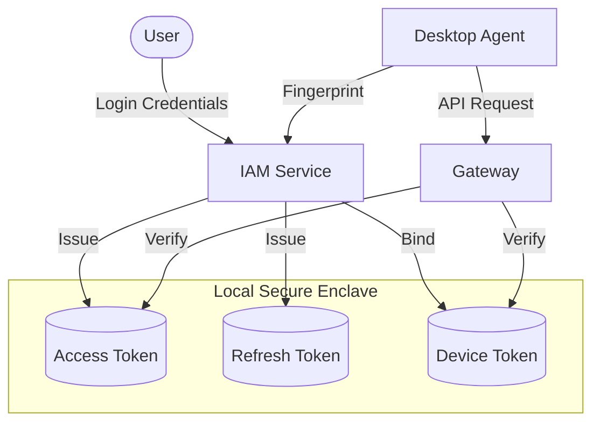
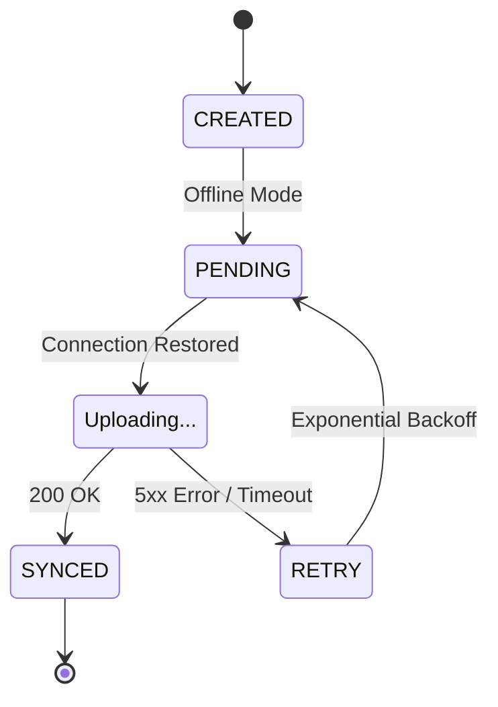

# NeatSprint – Step 16: Desktop Agent Security & Offline Design

This document details the **Security Controls** and **Offline Resilience** mechanisms of the Desktop Agent. It complements the architecture defined in **[Step 15: Desktop App Architecture](step15-desktop-app-architecture.md)**.

---

## 1. Device Trust Model

The Desktop Agent operates on a **Zero Trust** principle. We assume the environment is hostile; therefore, the agent must prove its identity and integrity for every session.

### 1.1. Device Binding (Hardware Fingerprinting)
Upon initialization, the agent generates a comprehensive Request for unique identification.

| Signal Component | Function |
| :--- | :--- |
| **CPU Serial** | Uniquely identifies processor. |
| **Disk UUID** | Uniquely identifies primary storage. |
| **MAC Address** | Network interface identifier. |
| **OS Information** | Kernel version / Build number. |

**Policy**: The `device_id` (UUIDv7) is cryptographically bound to a hash of these signals. If the underlying hardware changes (e.g., cloning the VM), the **Device Token** is invalidated.

### 1.2. Authentication Hierarchy

---

## 2. Local Encryption Strategy (Data-at-Rest)

To protect sensitive screenshot data and worklogs on potentially insecure end-user devices, we employ **Full Database Encryption**.

### 2.1. Cryptographic Standard
-   **Engine**: **SQLCipher 4** (Community Edition).
-   **Algorithm**: **AES-256-CBC**.
-   **Page Size**: 4096 bytes.

### 2.2. Key Management (KDF)
The encryption key is never stored in plain text. It is derived at runtime using **Argon2id**.

$$ \text{DbKey} = \text{Argon2id}(\text{UserPassword} + \text{DeviceSalt}, \text{Iterations}=3, \text{Memory}=64MB) $$

-   **Key Storage**: The derived `DbKey` is held in **RAM only** (pinned memory).
-   **Persistence**: A wrapped version of the key is stored in the **OS Keychain** (Windows Credential Manager / macOS Keychain), protected by the user's OS login.

---

## 3. Offline Resilience & Sync Logic

The agent is designed to function indefinitely without internet connectivity.

### 3.1. Sync State Machine
Data consistency is managed via a strict state machine for every local record (Task, Worklog, Screenshot).

### 3.2. Conflict Resolution
-   **Strategy**: **Last-Write-Wins (LWW)** based on `updated_at` (UTC).
-   **Truth**: The Server is the ultimate source of truth. If a local record conflicts with a newer server record (during Pull Sync), the local record is overwritten *unless* it has pending local changes.

---

## 4. Anti-Tampering & Integrity

Measures to prevent users from modifying the agent to falsify worklogs or disable monitoring.

| Measure | Implementation |
| :--- | :--- |
| **Code Signing** | Binaries signed with **Ed25519** private key. OS SmartScreen/Gatekeeper verified. |
| **Watchdog Process** | A separate lightweight daemon monitors the main process. If the main agent is killed, the watchdog restarts it and logs the event. |
| **Secure Time** | Agent uses **Monotonic Clock** for duration tracking, independent of OS system time (prevents "System Clock rollback" attacks). |
| **Heartbeat** | Periodic ping to server. Missing heartbeats trigger "Agent Offline" alerts for managers. |
| **DLL Pinning** | Static linking of critical libraries to prevent DLL injection attacks. |

---

## 5. Admin Controls (Remote Wipe)

Administrators have governance capabilities directly affecting the local agent.

| Action | Trigger | Local Effect |
| :--- | :--- | :--- |
| **Suspend** | API Response `403 Account Suspended` | Pause capture. Lock UI. |
| **Revoke** | API Response `401 Token Revoked` | Delete stored tokens. Redirect to Login. |
| **Wipe** | API Response `403 Device Banned` | **Secure Delete** (overwrite) reliable local DB. Delete tokens. Self-terminate. |

---

## 6. Privacy & Compliance

### 6.1. The "Glass House" Principle
The user must always know *exactly* what is being recorded.
-   **Tray Icon**: Changes color during active recording (🔴 Recording | 🟢 Idle).
-   **Notification**: Toast notification on screen capture.
-   **Local Audit**: User can browse `%AppData%/NeatSprint/logs` to see plaintext audit trail of what was sent to the server.

---

**End of Security Design**
