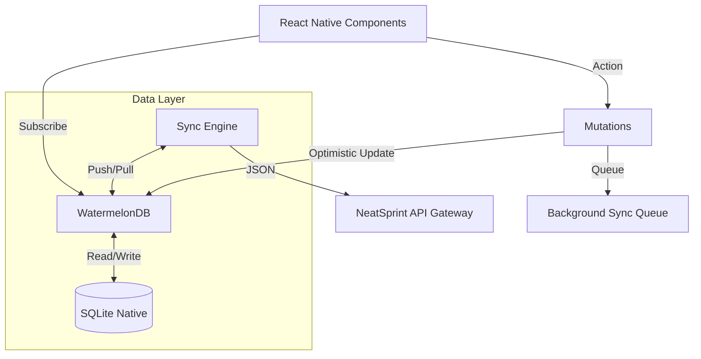

# NeatSprint – Step 17: Mobile App Architecture (React Native)

The Mobile App extends the platform to iOS and Android, leveraging **React Native** to share business logic and types with the Web and Desktop clients.

---

## 1. Technical Stack

| Component | Technology | Rationale |
| :--- | :--- | :--- |
| **Framework** | **React Native (Expo)** | "Write once, run everywhere" with access to native APIs via Expo SDK. |
| **Language** | **TypeScript** | Shared types (`.d.ts`) with Web/Desktop apps. |
| **State Mgmt** | **TanStack Query + Zustand** | Consistent data fetching and store logic across all frontend apps. |
| **Local DB** | **WatermelonDB** | High-performance, reactive local database built on SQLite (JSI). |
| **Secure Storage** | **Expo SecureStore** | AES-256 encrypted storage for JWTs (Keychain/Keystore). |

---

## 2. App Architecture (Offline-First)

The app uses an "Offline-First" approach, treating the Local DB as the single source of truth for UI components.

### 2.1. Shared Logic Strategy
-   **Hooks**: `useTask`, `useAuth` shared via a private npm workspace package or monorepo `packages/shared`.
-   **Types**: API response types shared from backend.
-   **UI**: "Primitive" components (Buttons, Inputs) adapted for Native (using libraries like `tamagui` or `NativeWind` for shared styling tokens).

---

## 3. Authentication & Biometrics

### 3.1. Primary Login
-   **Flow**: Native Login Screen (Email/Password) or SSO (WebBrowser session).
-   **Storage**: Access/Refresh tokens stored in `Expo.SecureStore`.

### 3.2. Biometric Unlock
-   **Library**: `expo-local-authentication`.
-   **Flow**:
    1.  App launch checks `hasBiometricsEnabled` flag.
    2.  Prompts FaceID/TouchID.
    3.  Success -> Retrives Refresh Token from SecureStore -> Refreshes Session.

---

## 4. Push Notifications

-   **Service**: **Expo Push Notifications** (wraps FCM & APNs).
-   **Flow**:
    1.  Device gets `ExponentPushToken`.
    2.  Sends token to Backend `POST /api/v1/devices`.
    3.  Backend sends notification payload to Expo Push API.
-   **Handling**:
    -   **Foreground**: `expo-notifications` displays a toast.
    -   **Background**: Deep link handling (`neatsprint://task/:id`) navigates to specific screen.

---

## 5. Offline Sync Engine

To support work in low-connectivity zones, we use **WatermelonDB's Sync Protocol**.

### 5.1. Pull (Server -> Client)
1.  **Request**: `GET /sync?last_pulled_at=1234567890`.
2.  **Response**: Changelog of `created`, `updated`, `deleted` records since timestamp.
3.  **Action**: WatermelonDB batch updates local SQLite.

### 5.2. Push (Client -> Server)
1.  **Trigger**: User makes changes (creates task, comments).
2.  **Local**: Record marked as `_status: 'created'`.
3.  **Sync**:
    -   Agent gathers all "dirty" records.
    -   `POST /sync/push` with changeset.
    -   Server acknowledges -> Local records marked `synced`.

---

## 6. Security Specifics

-   **JSI Bridge**: WatermelonDB uses JSI (JavaScript Interface) for synchronous, fast database access, avoiding the slow JSON bridge.
-   **SSL Pinning**: Crucial for public WiFi usage.
-   **Root Detection**: `expo-device` checks to warn or block running on rooted/jailbroken devices.

---

## 7. Deployment Pipelines (EAS)

We use **Expo Application Services (EAS)** for CD.

-   **EAS Build**:
    -   Cloud builds for IPA (iOS) and APK/AAB (Android).
    -   Avoids need for Mac build agents in standard CI.
-   **EAS Update**:
    -   Over-the-air (OTA) updates for JS-only changes (bug fixes) without App Store review.
-   **Channels**:
    -   `preview`: PR merges -> QA builds.
    -   `production`: Tagged releases -> App Store / Play Store.

---

**End of Mobile Architecture**
