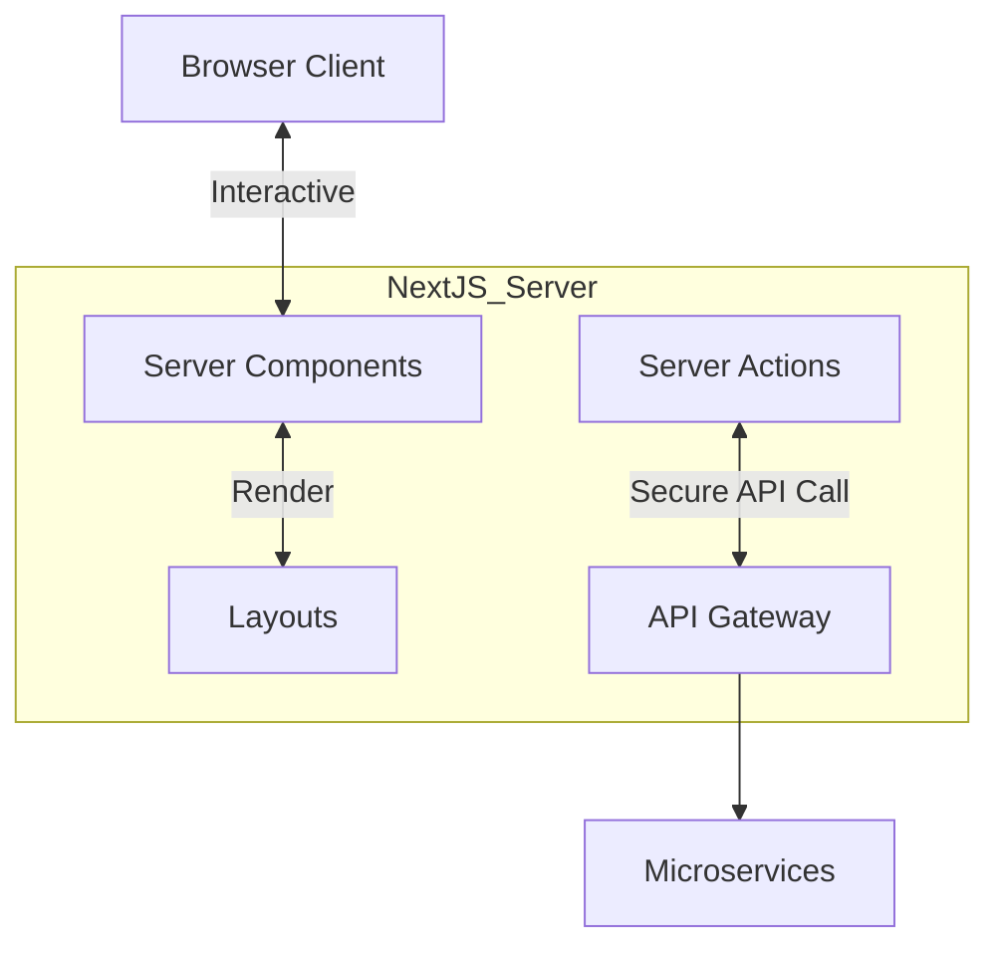

# NeatSprint – Step 18: Web App Architecture

The **Web Application** is the primary management interface for NeatSprint. It serves Project Managers, Team Leads, and Admins.

---

## 1. Technical Stack

| Component | Technology | Rationale |
| :--- | :--- | :--- |
| **Framework** | **Next.js 14+ (App Router)** | Server Components for performance, built-in routing. |
| **Language** | **TypeScript** | Strict typing for enterprise-grade reliability. |
| **Styling** | **Tailwind CSS + ShadcnUI** | Fast, consistent, accessible UI components. |
| **State Mgmt** | **TanStack Query (React Query)** | Server state management, caching, and optimistic updates. |
| **Global Store** | **Zustand** | Minimal client-side state (e.g., UI toggles, session data). |

---

## 2. Architecture Pattern

We adhere to the **BFF (Backend for Frontend)** pattern implicitly provided by Next.js Server Actions / API Routes, interacting with the downstream API Gateway.



### 2.1. Directory Structure (Feature-Sliced Design)
```text
src/
├── app/                    # Next.js App Router (Pages & Layouts)
│   ├── (auth)/             # Login, Register, Forgot Password
│   ├── (dashboard)/        # Main App (Sidebar layout)
│   │   ├── [tenant]/       # Tenant context
│   │   │   ├── projects/
│   │   │   ├── reports/
│   │   │   └── settings/
├── components/             # Shared UI Components
│   ├── ui/                 # Shadcn Atoms (Button, Input)
│   ├── domain/             # Business Widgets (TaskCard, KanbanBoard)
├── lib/                    # Utilities (API Client, Date Formatting)
├── hooks/                  # Custom React Hooks
└── types/                  # TypeScript Interfaces (Shared with Backend via OpenAPI gen)
```

---

## 3. Data Fetching & Caching

### 3.1. Server Components (RSC)
-   **Fetch**: Direct fetch in `page.tsx` or `layout.tsx`.
-   **Cache**: Next.js `fetch` cache tags used for static data (e.g., Subscription Plans).
-   **Dynamic**: `export const dynamic = 'force-dynamic'` for dashboard data.

### 3.2. Client Components
-   **Fetch**: `useQuery` (TanStack Query) for interactive data (Kanban boards, Forms).
-   **Mutations**: `useMutation` for creates/updates with standard `onSuccess: invalidateQueries` pattern.

---

## 4. Authentication flow

### 4.1. NextAuth.js (or Auth.js)
-   **Provider**: Custom Credentials Provider calling `neatsprint-iam`.
-   **Session**: JSON Web Token (JWT) strategy.
-   **Handlers**:
    -   `authorize()`: Calls backend `/auth/login`, receives Access/Refresh tokens.
    -   `jwt()`: Refreshes expired Access Tokens using the long-lived Refresh Token.
    -   `session()`: Exposes user profile and permissions to the UI.

### 4.2. Middleware Protection
`middleware.ts` runs on Edge Runtime:
1.  Check content of `next-auth.session-token`.
2.  Validate expiration.
3.  Redirect to `/login` if invalid/missing.
4.  Inject `X-Tenant-ID` header for downstream API calls (if proxying).

---

## 5. Security Measures

-   **CSP**: Content Security Policy headers configured in `next.config.js`.
-   **XSS**: React automatically escapes output.
-   **CSRF**: Built-in Next.js protection for Server Actions.
-   **Token Handling**: Access Tokens stored in **HTTP-Only Cookies** (secure, same-site) via NextAuth. They are **never** exposed to client-side JS (localStorage).

---

## 6. Performance Optimization

-   **Image Optimization**: `next/image` for automatic formatting/resizing.
-   **Code Splitting**: Automatic per-route splitting.
-   **Lazy Loading**: `next/dynamic` for heavy components (e.g., Complex Charts, Rich Text Editors).
-   **Pre-fetching**: TanStack Query `prefetchQuery` on hover.

---

**End of Web App Architecture**
