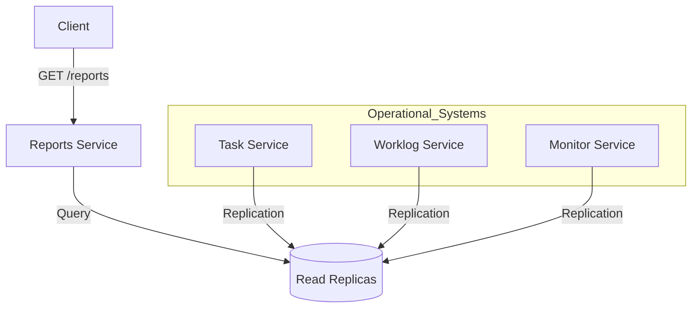

# NeatSprint – Step 19: Reports & Analytics Architecture

The **Reports Service** provides actionable insights into productivity, process efficiency, and compliance. It is designed as a high-performance **Read-Only** system.

---

## 1. Architecture: The Read-Model Pattern

To ensure heavy analytical queries never slow down the operational system (e.g., creating tasks), Reports uses a separate data path.

### 1.1 Data Source Strategy
-   **MVP**: Direct SQL queries on **Read Replicas** of domain databases.
-   **Scale**: Future migration to a dedicated **Data Warehouse** (e.g., ClickHouse) via ETL pipelines.

---

## 2. Core Report Definitions

### 2.1 Productivity Reports
Focus: *How is time being spent?*
-   **Time by Project**: Breakdown of hours logged per project key.
-   **Time by User**: Individual contribution metrics.
-   **Efficiency**: `(Actual Hours / Estimated Hours)` ratio.

### 2.2 Agile/Process Reports
Focus: *Are we delivering on time?*
-   **Sprint Burndown**: Daily tracking of remaining Story Points/Hours.
-   **Velocity Chart**: Historical view of completed points per sprint.
-   **Cycle Time**: Average time from `IN_PROGRESS` to `DONE`.

### 2.3 Monitoring & Compliance
Focus: *Is the work verified?*
-   **Audit Summary**: Count of user sessions, screenshots captured, and **deletion rates**.
-   **Transparency Log**: A report for the *Employee* showing exactly what data was captured and what they deleted.
-   **Privacy Rule**: *Deleted screenshots are excluded from all visual reports*, but the "Deletion Event" (timestamp) remains for compliance auditing.

### 2.4 AI Insights (Enterprise)
-   **Daily Standup Summary**: AI-generated text summary of worklogs affecting a specific team.
-   **Anomaly Detection**: Alerts for unusual patterns (e.g., "30h logged in 24h period" or "Zero activity for 3 days").

---

## 3. Export Engine

Generating reports for large teams requires asynchronous processing.

### 3.1 Flow
1.  **Request**: User clicks "Export PDF".
2.  **Queue**: Job pushed to `reports-worker` queue (Redis).
3.  **Process**: Worker fetches data, renders HTML template, converts to PDF (Headless Chrome/Puppeteer).
4.  **Delivery**: File uploaded to S3 (Temp Bucket), Signed URL emailed to user.

### 3.2 Supported Formats
-   **PDF**: Executive summaries, visual charts.
-   **CSV/Excel**: Raw data for external analysis.
-   **JSON**: Integration with Bi-Tools (PowerBI/Tableau).

---

## 4. API Structure

All endpoints allow filtering by `date_range`, `team_id`, and `project_id`.

| Metric | Endpoint | Application |
| :--- | :--- | :--- |
| **Productivity** | `GET /reports/productivity` | Managers tracking hours/budget. |
| **Sprints** | `GET /reports/agile/burndown` | Scrum Masters during standup. |
| **Compliance** | `GET /reports/compliance/audit` | HR/Admins verifying policy. |
| **Exports** | `POST /reports/jobs/export` | Generating offline files. |

---

## 5. Security Enforcements

Reporting is the most sensitive part of the system.

1.  **Tenant Isolation**: Strict `WHERE tenant_id = X` on all queries.
2.  **RBAC Scope**:
    -   `Standard User`: Can only see *their own* data.
    -   `Manager`: Can see *their team's* data.
    -   `Admin`: Can see *organization-wide* data.
3.  **Aggregation Privacy**: Some regions require reports to be aggregated (min 5 users) to prevent individual monitoring. System supports "Aggregation Mode" toggle per tenant.

---

**End of Reports Architecture**
