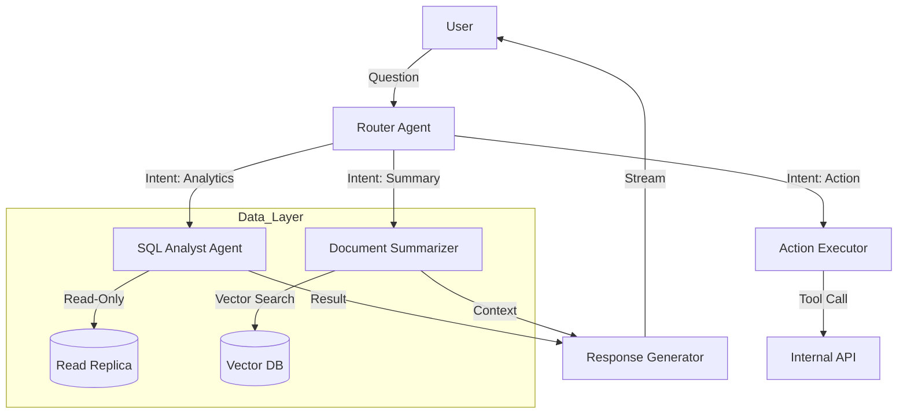

# NeatSprint – Step 21: AI Architecture (Enterprise)

The **AI Service** is an intelligent orchestration layer that provides "Assistive Intelligence" to the platform. It is built on a **RAG (Retrieval-Augmented Generation)** architecture to ensure answers are grounded in the tenant's data, not hallucinations.

---

## 1. Architecture: The Agentic RAG Pipeline

We use a "Router-Solver" pattern where a central router directs queries to specialized sub-agents.

### 1.1 Components
-   **Router Agent**: A fast, small model (e.g., Llama-3-8B) that classifies intent.
-   **SQL Analyst**: Translates natural language to secure SQL (restricted to read-only views).
-   **Summarizer**: Fetches text logs/comments and generates concise digests.
-   **Action Executor**: Maps intent to API calls (e.g., "Create Ticket" -> `POST /tasks`).

---

## 2. The Privacy Guardrails

AI in an enterprise context must be strictly bounded. We enforce a **"Zero-Trust"** approach to AI data access.

### 2.1 Guardrail Layer
Before any data is passed to an LLM, it goes through the Guardrail:
1.  **PII Scrubbing**: Regex/NER to replace emails/phones with `<EMAIL>`.
2.  **Scope Validation**: The AI service calls internal APIs using the **User's JWT**. It cannot access data the user cannot see.
3.  **Deleted Data Filter**: "Deleted Screenshots" are rigorously excluded from the RAG context window.

### 2.2 Model Privacy
-   **Zero-Training Policy**: Customer data is *never* used to train foundation models.
-   **Ephemeral Context**: Data exists in the LLM's context window only for the duration of the request.

---

## 3. Capabilities & Use Cases

### 3.1 "NeatSprint Ask" (Assistant)
-   *User*: "What did I work on yesterday?"
-   *System*: RAG queries `work_logs` -> Summarizes timeline.
-   *User*: "Create a bug for the login issue."
-   *System*: Extrapolates fields -> Calls `POST /tasks` (Draft Mode).

### 3.2 Automated Standups
-   **Trigger**: 9:00 AM Daily.
-   **Process**:
    1.  Fetch yesterday's closed tasks + commits + worklogs.
    2.  Summarize into a 3-bullet update.
    3.  Post to Team Chat.

### 3.3 Anomaly Detection
-   **Passive Monitoring**: Analyzes work patterns for burnout risk (e.g., "User logged 14 hours for 3 days").
-   **Alerting**: Notifies Manager (based on configuration).

---

## 4. Technical Stack

| Component | Technology | Rationale |
| :--- | :--- | :--- |
| **LLM Provider** | **OpenAI / Anthropic / Gemini** | Best-in-class reasoning for complex tasks. |
| **Orchestrator** | **LangChain / LlamaIndex** | Standard framework for RAG & Tool use. |
| **Vector DB** | **pgvector (PostgreSQL)** | Simplifies stack by keeping vectors with data. |
| **Streaming** | **Server-Sent Events (SSE)** | Low-overhead streaming for "Typing..." effect. |

---

## 5. Security & RBAC

| Guardrail | Enforcement |
| :--- | :--- |
| **Authentication** | Request must have valid `Authorization: Bearer` token. |
| **Data Scope** | AI Service impersonates the user via **On-Behalf-Of (OBO)** flow. |
| **Action Consent** | "Destructive" actions (Create/Update/Delete) require human confirmation UI. |
| **Audit Log** | Every Prompt + Response + Source Documents logged to `ai_audit_log`. |

---

**End of AI Architecture**
