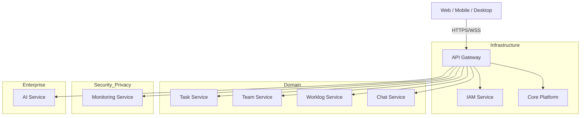

# NeatSprint – Step 3: Microservice Boundaries & Responsibilities

This document serves as the **architectural source of truth** for service separation in NeatSprint. It enforces:
*   **Zero-Shared-Database Policy**: Each service owns its schema.
*   **Explicit Dependency Chains**: Services consume other services only via public APIs.
*   **Boundaries**: Clear domain isolation to prevent monolith creep.

---

## 1. High-Level Architecture

The system follows a strict **Microservice Pattern** behind a specific **API Gateway**.

---

## 2. Infrastructure Services

### 2.1. API Gateway (`neatsprint-apigw`)
**Role**: The "Front Door" of the system.
*   **Primary Responsibility**: Request Routing, SSL Termination, & Rate Limiting.
*   **Critical constraint**: Must NOT perform complex business logic or DB lookups.
*   **Dependencies**: None (stateless).

### 2.2. IAM Service (`neatsprint-iam`)
**Role**: The "Single Source of Trust" for Identity.
*   **Responsibilities**:
    *   Authentication (Login, Refresh, OAuth2).
    *   Authorization (RBAC Policy Definitions).
    *   User Lifecycle (Invite, register, disable).
*   **Owned Data**: `users`, `roles`, `permissions`, `invitations`.
*   **Dependencies**: None (Foundational).

### 2.3. Core Platform Service (`neatsprint-core`)
**Role**: The "SaaS Engine" handling multi-tenancy.
*   **Responsibilities**:
    *   Tenant provisioning and lifecycle.
    *   Application Registry ("What apps can this tenant use?").
    *   Subscription Plan enforcement.
*   **Owned Data**: `tenants`, `applications`, `tenant_applications`.
*   **Dependencies**: None (Foundational).

---

## 3. Domain Services

### 3.1. Task & Project Service (`neatsprint-task`)
**Role**: The core project management engine.
*   **Responsibilities**:
    *   Project metadata & settings.
    *   Backlog Item (Task/Story/Bug) CRUD.
    *   Sprint Lifecycle management.
    *   **Assignment**: Enforcing property "One Task = One User".
*   **Owned Data**: `projects`, `sprints`, `backlog_items`, `task_assignments`.
*   **Dependencies**: `IAM Service` (validating user existence).

### 3.2. Team Service (`neatsprint-team`)
**Role**: Organizational grouping.
*   **Responsibilities**:
    *   Defining Teams (Squads/Groups).
    *   Mapping Users to Team entities.
*   **Owned Data**: `teams`, `team_members`, `project_teams`.
*   **Dependencies**: `IAM Service`.

### 3.3. Worklog Service (`neatsprint-worklog`)
**Role**: The productivity accountant.
*   **Responsibilities**:
    *   Processing "Start/Stop" signals from clients.
    *   Calculating duration and timesheets.
    *   Validating time entries against assigned tasks.
*   **Owned Data**: `work_logs`, `time_entries`.
*   **Dependencies**: `Task Service` (validating task IDs).

### 3.4. Chat Service (`neatsprint-chat`)
**Role**: Collaboration backbone.
*   **Responsibilities**:
    *   Real-time message routing (WebSockets).
    *   Persistence of chat history.
*   **Owned Data**: `chat_channels`, `team_messages`.
*   **Dependencies**: `Team Service` (validating channel members).

### 3.5. Reports Service (`neatsprint-reports`)
**Role**: Read-heavy analytics.
*   **Responsibilities**:
    *   Aggregating data from multiple domains for consumption.
    *   Generating PDF/CSV exports.
*   **Owned Data**: *Read-Replica Views* (No write-master data).
*   **Dependencies**: Read access to `Task`, `Worklog`, and `Monitoring` data streams.

---

## 4. Security & Privacy Services

### 4.1. Monitoring Service (`neatsprint-monitoring`)
**Role**: The "Black Box" flight recorder.
*   **Responsibilities**:
    *   Ingesting encrypted screenshot blobs.
    *   Managing the "User Deletion Window" (Privacy Logic).
    *   Serving audit logs of deletions.
*   **Owned Data**: `monitoring_sessions`, `screenshots`.
*   **Critical Constraints**:
    *   **Encryption**: Must encrypt metadata and storage paths at rest.
    *   **Privacy**: Must NEVER serve a binary blob if `deleted_by_user=true`.

---

## 5. Enterprise Services

### 5.1. AI Service (`neatsprint-ai`)
**Role**: The intelligent assistant.
*   **Responsibilities**:
    *   Generating text summaries of work logs.
    *   Answering natural language queries (RAG).
*   **Owned Data**: `ai_summaries`, `conversation_history`.
*   **Constraints**:
    *   Runs as a restricted `AI_AGENT` service account.
    *   **Strict Barrier**: Cannot access deleted screenshots.

---

## 6. Service Communication Rules

1.  **Sync Communication**: HTTP/REST for command-response (e.g., "Create Task").
2.  **Async Events**: (Future) RabbitMQ/Kafka for side effects (e.g., "Task Created" -> "Update Search Index").
3.  **No Backdoors**: A Service A must NEVER connect to Service B's database.

---
**End of Step 1 Defintion**
