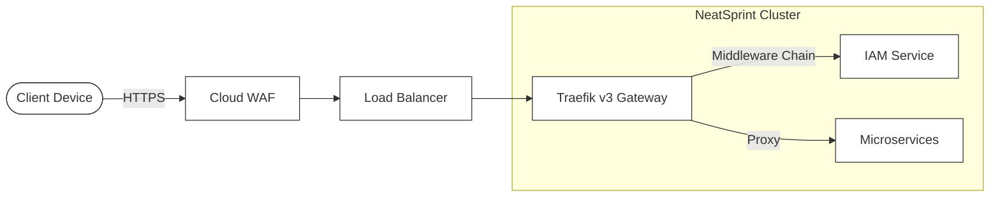
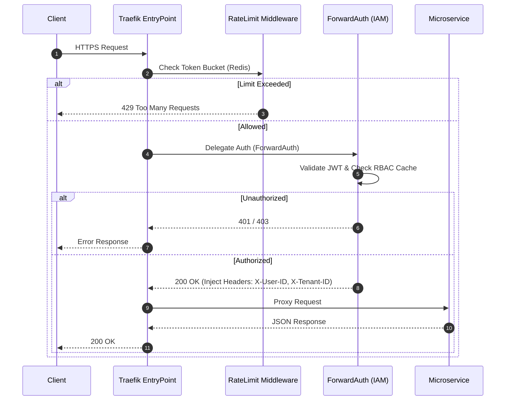

# NeatSprint – Step 4: API Gateway Architecture

The API Gateway is the unified "Front Door" to the microservices ecosystem. We use **Traefik v3** for its native container discovery, dynamic configuration, and robust middleware chain capabilities.

---

## 1. Technical Implementation

| Component | Technology | Rationale |
| :--- | :--- | :--- |
| **Engine** | **Traefik v3** | Container-native, auto-discovery of Docker services, simple YAML middleware config. |
| **Auth Plugin** | **ForwardAuth** | Offloads JWT validation to a lightweight sidecar or `neatsprint-iam`. |
| **Rate Limit** | **Redis (Middleware)** | Distributed counting for high-performance throttling. |

---

## 2. Architecture Overview

Traefik sits at the edge, routing traffic from the implementation-agnostic Load Balancer to internal microservices via defined **Routers** and **Middlewares**.



---

## 3. Request Lifecycle (Middleware Chain)

Traefik processes requests through a chain of attached middlewares before invoking the service.



### 3.1 Identity Injection (Header Enrichment)
After validating the JWT, the Gateway strips the `Authorization` header and injects trusted headers for downstream services:
-   `X-User-ID`: `uuid-v7` (from sub)
-   `X-Tenant-ID`: `uuid-v7` (from claim)
-   `X-Roles`: `admin,manager` (from scope)

*Downstream services strictly trust these headers and do not re-verify the signature (Performance Optimization).*

---

## 4. Service Routing & Path Mapping

Traefik routes traffic based on path prefixes to specific internal services.

| Path Prefix | Target Service | Function |
| :--- | :--- | :--- |
| `/auth` | `neatsprint-iam:8001` | Login, Refresh, Key Rotation. |
| `/tasks` | `neatsprint-task:8002` | CRUD Tasks, Sprints. |
| `/teams` | `neatsprint-team:8003` | Member management. |
| `/work` | `neatsprint-worklog:8004` | Time tracking. |
| `/monitor` | `neatsprint-monitor:8005` | Screenshot upload. |
| `/chat` | `neatsprint-chat:8006` | WebSocket Upgrade. |
| `/reports` | `neatsprint-reports:8007` | Async PDF generation. |
| `/ai` | `neatsprint-ai:8008` | RAG Assistant. |

---

## 5. Security & Traffic Controls

### 5.1. Rate Limiting (`RateLimit`)
We use Traefik's native rate limiting middleware backed by Redis for distributed counting.

| Middleware Name | Average (req/s) | Burst | Audience |
| :--- | :--- | :--- | :--- |
| `limit-public` | 1 | 10 | Unauthenticated / Login endpoints. |
| `limit-user` | 20 | 50 | Standard authenticated users. |
| `limit-service` | 100 | 200 | Internal service-to-service communication. |

### 5.2. Resilience Strategies
-   **Timeouts**: Hard **30s** timeout on all upstream calls to prevent resource holding.
-   **Circuit Breaker**:
    -   **Trigger**: If 50% of requests fail (5xx) over a 10s window.
    -   **Action**: Open circuit (Fail Fast) for 30s before retrying.

### 5.3. CORS & Headers (`Headers`)
Strict policies applied globally via EntryPoint.
-   **Allowed Origins**: `https://app.neatsprint.com`, `https://admin.neatsprint.com`.
-   **Computed Headers**: `Strict-Transport-Security`, `X-Content-Type-Options: nosniff`, `Content-Security-Policy`.

### 5.4. Authentication (`ForwardAuth`)
Traefik delegates authentication to the `neatsprint-iam` service.
-   **Address**: `http://neatsprint-iam:8001/auth/verify`
-   **Headers injected**: `X-User-ID`, `X-Tenant-ID`, `X-Roles`.

---

## 6. Observability & Tracing

### 6.1. Distributed Tracing
Traefik integrates with **OpenTelemetry**.
-   **Trace ID**: Generated automatically (`X-B3-TraceId` or `traceparent`).
-   **Spans**: Created for Router, Middlewares, and Service calls.

### 6.2. Access Logs
JSON-structured logs for aggregation (FluentBit/Loki).

```json
{
  "time": "2023-10-27T10:00:00Z",
  "level": "info",
  "request_X_Request_ID": "req-123-abc",
  "downstream_Status": 200,
  "duration": 45000000
}
```

### 6.3. Key Metrics (Prometheus)
-   `traefik_entrypoint_requests_total`: Traffic volume.
-   `traefik_entrypoint_request_duration_seconds`: Latency (P95/P99).
-   `traefik_service_request_status`: Error rates (4xx/5xx).

---

## 7. Token Strategy Reference

| Token Type | Storage | Lifespan | purpose |
| :--- | :--- | :--- | :--- |
| **Access Token** | HttpOnly Cookie (Web) / SecureStore (Mobile) | 15 Mins | Short-lived API Auth. |
| **Refresh Token** | HttpOnly Cookie (Web) / SecureStore (Mobile) | 7 Days | Silent re-authentication. |
| **Device Token** | Encrypted SQLite (Desktop) | 30 Days | Long-lived session for Desktop Agent. |

---

**End of API Gateway Architecture**
