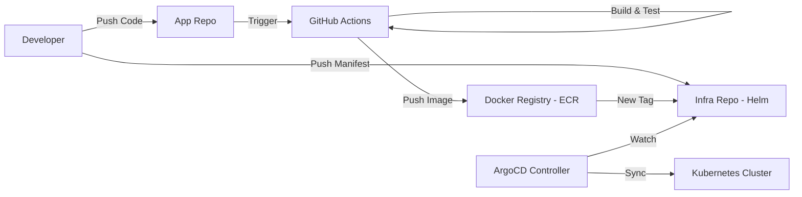

# NeatSprint – Step 5: Deployment & CI/CD Architecture

We employ a **GitOps** methodology for immutable, declarative infrastructure.

---

## 1. The GitOps Workflow (ArgoCD)

Deployment is "Pull-based" rather than "Push-based". CI does not touch the production cluster directly.

### 1.1 Why GitOps?
-   **Security**: CI Server doesn't need "Cluster Admin" credentials.
-   **Audit**: Every change to production is a Git Commit.
-   **Drift Detection**: ArgoCD automatically corrects manual changes made on the cluster.

---

## 2. CI Pipelines (GitHub Actions)

### 2.1 Commit Stage
Triggers on every push to `feature/*`.
1.  **Linters**: ESLint / Clippy (Rust).
2.  **Tests**: Unit + Integration tests.
3.  **Security**: SAST (Static Analysis) & Secret Scanning.

### 2.2 Build Stage
Triggers on merge to `develop` (Staging) or `main` (Prod).
1.  **Build**: Multi-stage Docker build.
    -   *Base*: `gcr.io/distroless/static-debian12` (Minimal attack surface, no shell).
2.  **Sign**: Cosign image using OIDC.
3.  **Push**: Upload to ECR with generic tag (`:latest`) and specific tag (`:sha-xyz` or `:v1.0.0`).

---

## 3. Kubernetes Architecture

### 3.1 Logical Isolation
-   **Namespace Strategy**:
    -   `ns-neatsprint-prod`: All microservices.
    -   `ns-neatsprint-monitoring`: Prometheus/Grafana.
    -   `ns-argocd`: GitOps tooling.

### 3.2 Pod Security Context
-   **No Root**: `runAsNonRoot: true`.
-   **Read-Only FS**: `readOnlyRootFilesystem: true`.
-   **Capabilities**: `drop: ["ALL"]`.

### 3.3 Secrets Management
We do **not** use Kubernetes Secrets (which are base64 encoded).
-   **Tool**: HashiCorp Vault / AWS Secrets Manager.
-   **Mechanism**: **Secrets Store CSI Driver**.
-   **Flow**: Secrets are mounted as an in-memory volume at runtime. Application reads `/mnt/secrets/db_password`.

---

## 4. Branching Strategy (Trunk-Based)

| Branch | Environment | Trigger |
| :--- | :--- | :--- |
| `main` | **Production** | Tag Release (`v1.2.0`). |
| `develop` | **Staging** | Merge/Push. |
| `feat/*` | **Ephemeral** | Pull Request Open (deploys temporary env). |

---

## 5. Infrastructure as Code (IaC)

Infrastructure is provisioned before the apps are deployed.

-   **Tool**: **Terraform** / OpenTofu.
-   **Scope**:
    -   VPC Networking.
    -   Managed Databases (RDS PostgreSQL, ElastiCache Redis).
    -   Kubernetes Control Plane (EKS).
    -   IAM Roles (IRSA).

---

## 6. Observability Stack

-   **Logs**: FluentBit -> Loki / Opensearch.
-   **Metrics**: Prometheus Operator -> Grafana.
-   **Tracing**: OpenTelemetry Collector -> Tempo / Jaeger.

---

**End of Deployment Architecture**
