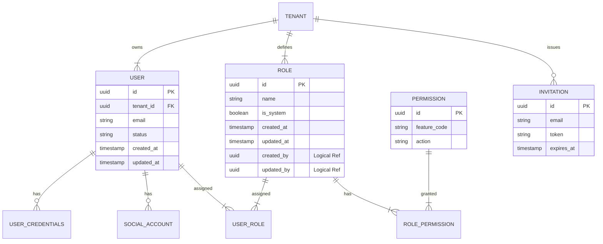
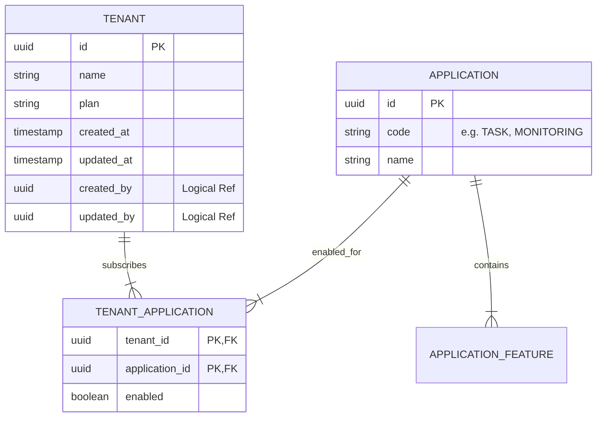
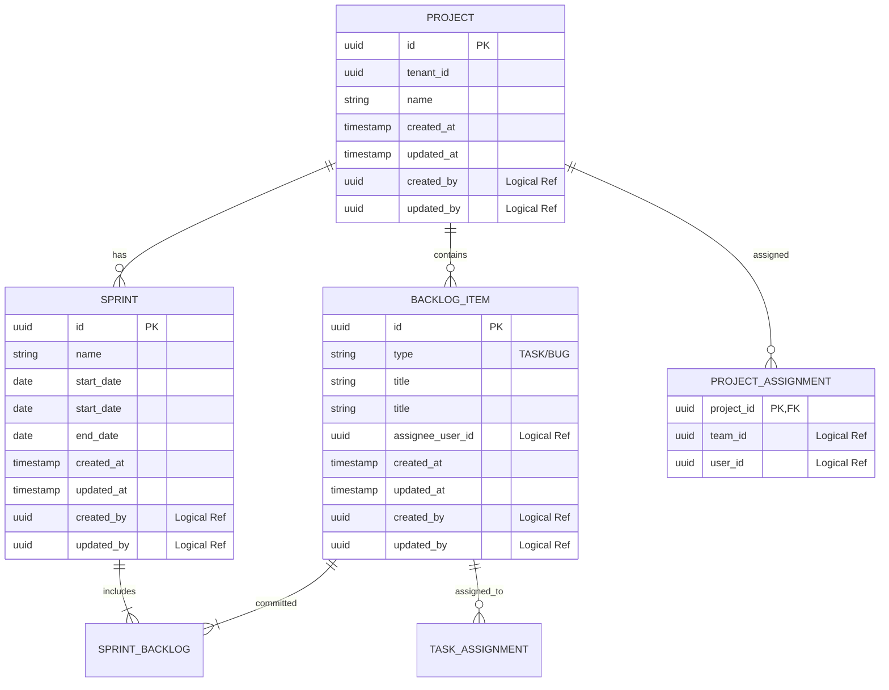
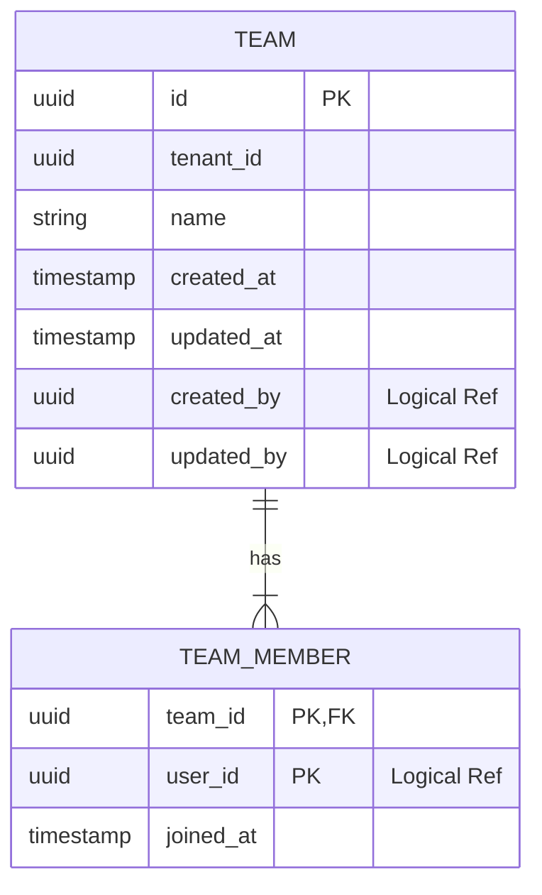
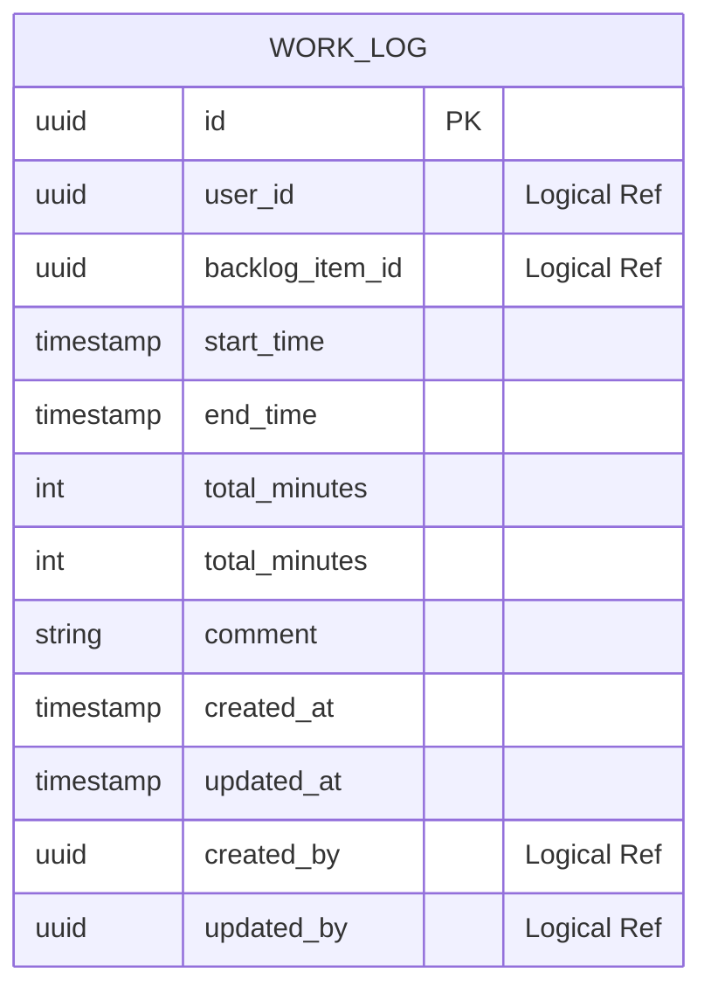
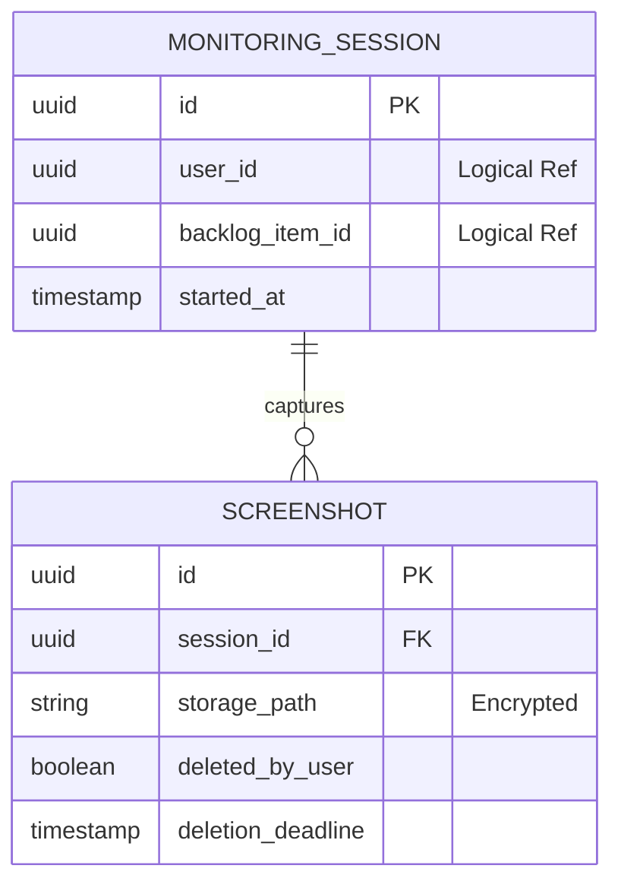
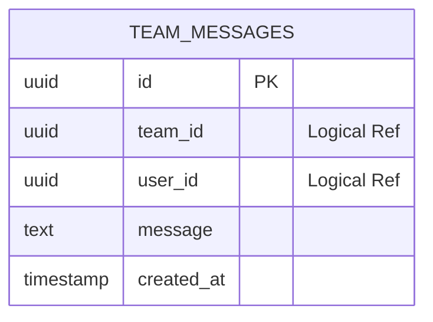
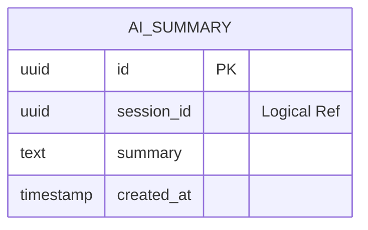

# NeatSprint – Step 6: Database ER Diagrams

This document visualizes the data architecture.
**Critical Rule**: These diagrams represent **Logical Schemas**. Each Service owns its own database. Cross-service relationships (e.g., `user_id` in Task Service) are **Logical References** (UUIDv7), not Foreign Keys.

---

## 1. IAM Service (`neatsprint-iam`)

**Owner**: Identity & Access Management  
**Scope**: Users, Roles, and Auth.

---

## 2. Core Platform Service (`neatsprint-core`)

**Owner**: Tenant Lifecycle & Billing  
**Scope**: Tenants, Applications, Features.

---

## 3. Task Service (`neatsprint-task`)

**Owner**: Project Management  
**Scope**: Projects, Backlogs, Sprints.

---

## 4. Team Service (`neatsprint-team`)

**Owner**: Organizational Structure  
**Scope**: Groups of users.

---

## 5. Worklog Service (`neatsprint-worklog`)

**Owner**: Time Tracking  
**Scope**: Time entries independently of task state.

---

## 6. Monitoring Service (`neatsprint-monitoring`)

**Owner**: Privacy & Compliance  
**Scope**: Screenshots and audit trails.

---

## 7. Chat Service (`neatsprint-chat`)

**Owner**: Real-time Comms  
**Scope**: Ephemeral and persistent messages.

---

## 8. Enterprise AI (`neatsprint-ai`)

**Owner**: Intelligence  
**Scope**: Summaries and cache.

---

## Summary of Reference Types

| Reference Type | Example | Description |
| :--- | :--- | :--- |
| **Physical FK** | `backlog_item_id` in `SPRINT_BACKLOG` | Enforced by Database Constraint. Both tables live in the same DB. |
| **Logical Ref** | `user_id` in `TASK_ASSIGNMENT` | a **UUIDv7** string. Application checks validity against IAM Service API. No DB Constraint. |