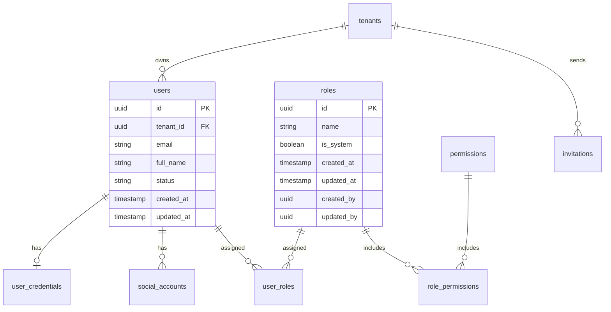
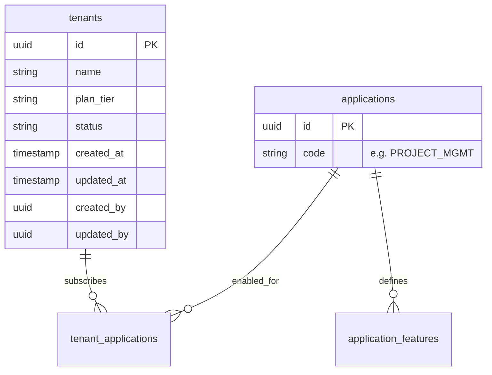
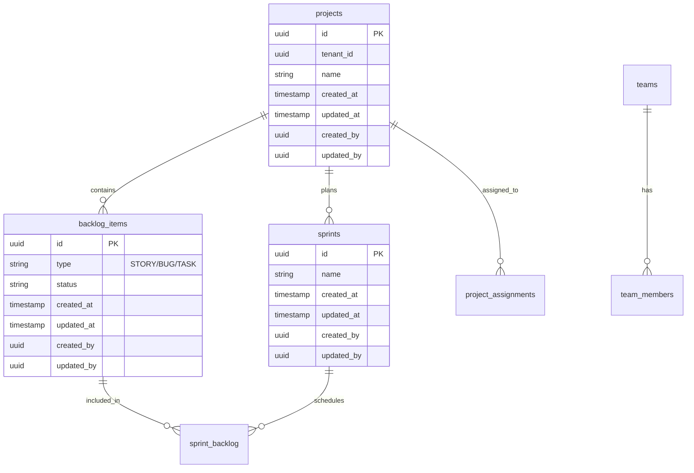
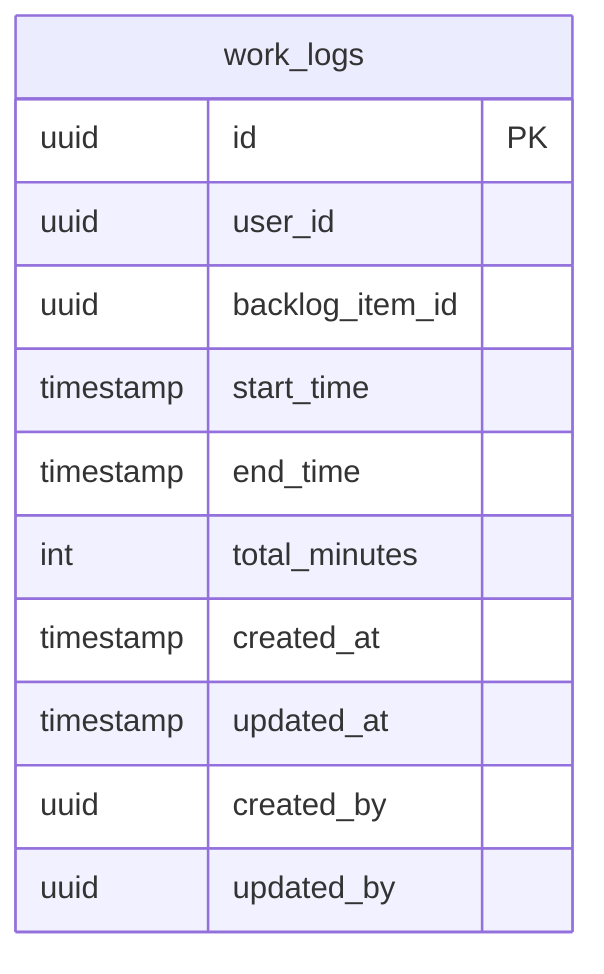
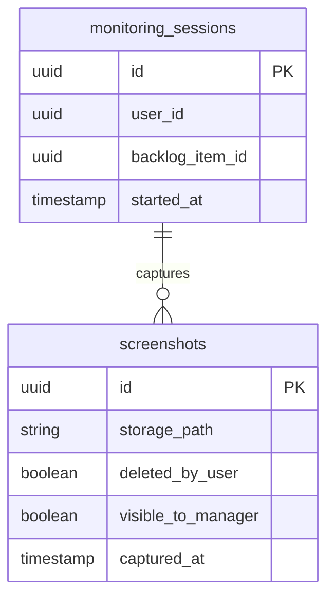

# NeatSprint – Step 7: Database Schemas & Data Model

This document defines the logical data model for NeatSprint's microservices. We use **PostgreSQL** as the primary datastore, with strict service isolation (no cross-service JOINs).

---

## 1. IAM Service Schema
**Responsibility**: Authentication, Identity, Access Control (RBAC).

### 1.1. Core Identity
| Table | Description |
| :--- | :--- |
| **users** | The core identity entity. Scoped to a `tenant_id`. |
| **user_credentials** | Stores bcrypt/argon2 password hashes. 1-to-1 with `users`. |
| **social_accounts** | OIDC/OAuth links (Google, GitHub). 1-to-Many with `users`. |

### 1.2. RBAC System
| Table | Description |
| :--- | :--- |
| **roles** | Defined sets of permissions (e.g., "Admin", "Developer"). |
| **permissions** | Granular capabilities `APPLICATION.FEATURE.ACTION` (e.g., `TASK.CREATE`). |
| **user_roles** | Many-to-Many link between Users and Roles. |
| **invitations** | Pending email invites with a time-limited token. |

---

## 2. Core Platform Service Schema
**Responsibility**: Tenant management, Subscription billing, Feature flags.

| Table | Description |
| :--- | :--- |
| **tenants** | The root organization entity. Billing anchor. |
| **applications** | Modules available in the platform (e.g., "Time Tracking", "Chat"). |
| **tenant_applications** | Toggle for which apps a tenant has enabled. |

---

## 3. Project & Task Service Schema
**Responsibility**: Work management, Sprints, Agile workflows.

| Table | Description |
| :--- | :--- |
| **projects** | A container for work. Can be linked to one or more Teams. |
| **backlog_items** | The unit of work (Task, Story, Bug). |
| **sprints** | Time-boxed iterations. |
| **teams** | Groupings of users for assignment purposes. |

---

## 4. Worklog Service Schema
**Responsibility**: Time tracking, Proof of Work.

| Table | Description |
| :--- | :--- |
| **work_logs** | Immutable record of time spent. Linked conceptually to `backlog_items` by ID. |

---

## 5. Monitoring Service Schema
**Responsibility**: Desktop agent telemetry, Screenshots, Privacy control.

| Table | Description |
| :--- | :--- |
| **monitoring_sessions** | A continuous session of work (e.g., "Coding on Task A"). |
| **screenshots** | Metadata for images. Actual binary is in Object Storage (S3). |

**Privacy Rule**: If `deleted_by_user` is TRUE, the `storage_path` is invalidated and `visible_to_manager` is set to FALSE.

---

## 6. Chat Service Schema
**Responsibility**: Real-time communication history.

| Table | Column | Type | Description |
| :--- | :--- | :--- | :--- |
| **team_messages** | `id` | UUID | Unique Message ID. |
| | `team_id` | UUID | Target channel/team. |
| | `user_id` | UUID | Sender. |
| | `message` | TEXT | Encrypted message content. |
| | `created_at` | TIMESTAMP | Send time. |

---

## 7. AI Service Schema
**Responsibility**: Generated insights and summaries.

| Table | Description |
| :--- | :--- |
| **ai_summaries** | Cached summaries of User or Sprint activity. |

---

## 8. Data Strategy & Standards

### 8.1. Global Identity (ID Format)
We use **UUIDv7** for all Primary Keys.
-   **Structure**: 48-bit Timestamp + Random bits.
-   **Benefit**: Time-sortable (good for B-Tree indexes) and collision-resistant for offline generation.

### 8.2. Audit Trail
All primary entities (`users`, `projects`, `tasks`, etc.) include standard audit columns:
-   `created_at`, `updated_at`: Timestamps.
-   `created_by`, `updated_by`: Logical Reference (UUID) to the User who performed the action.

### 8.3. Partitioning Strategy
For high-volume tables, we use Declarative Partitioning:
-   **`work_logs`**: Partition by Range (`start_time`) - Monthly.
-   **`screenshots`**: Partition by Range (`captured_at`) - Weekly.
-   **`team_messages`**: Partition by Hash (`team_id`) or Range (`created_at`).

### 8.4. Encryption at Rest
Sensitive columns use application-level encryption (or database-level TDE):
-   `user_credentials.password_hash`: **Argon2id**.
-   `screenshots.storage_path`: Only accessible via pre-signed URLs with short TTL.

---

**End of Database Schemas**