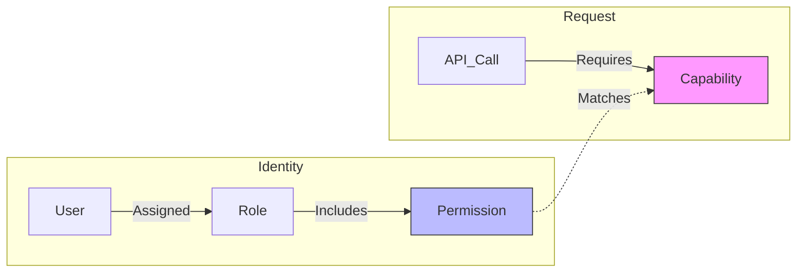
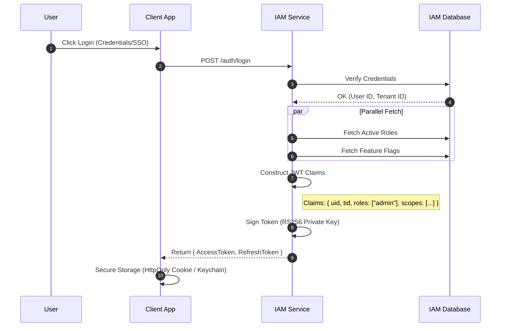
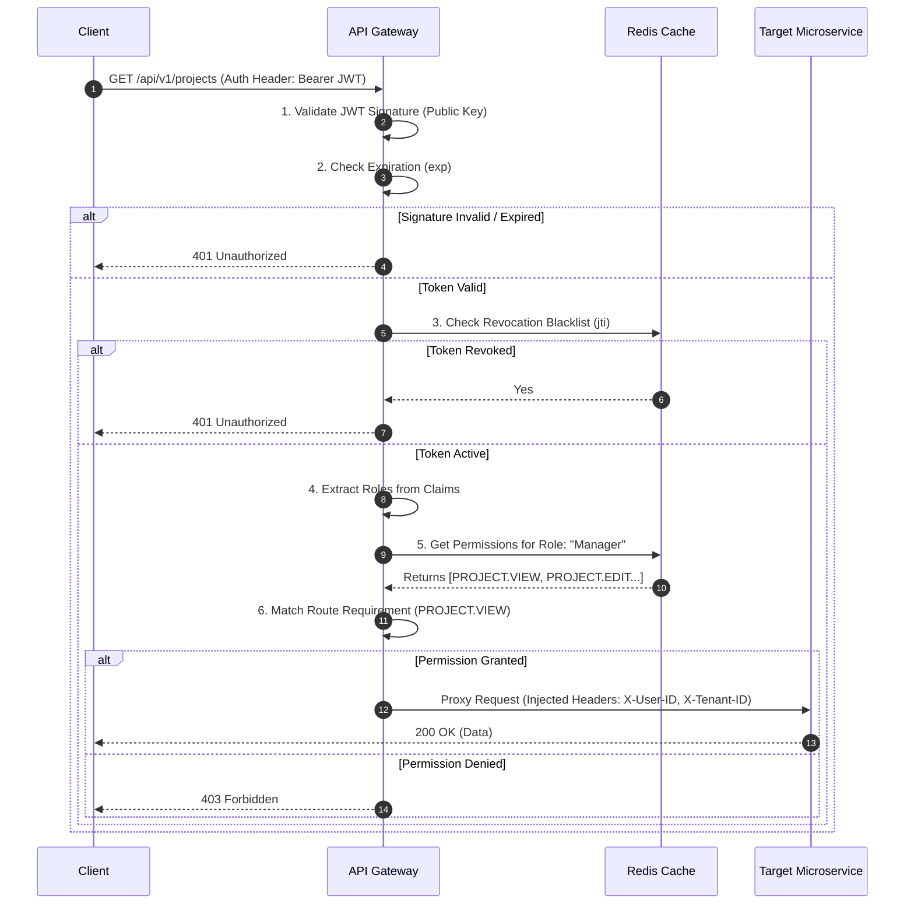

# NeatSprint – Step 9: Authorization Enforcement Flow (RBAC)

This document details the runtime security model, explaining how permissions are issued, cached, and enforced across the microservices architecture.

---

## 1. Principles
-   **Zero Trust**: Internal services must still validate JWTs (unless mTLS is strictly enforced, but token passing is preferred for context).
-   **Policy Decoupling**: Authorization logic (Policies) is separate from Business Logic.
-   **Fail-Closed**: If the IAM service or Cache is down, access is DENIED.

---

## 2. RBAC Logic Model

Authorization is an intersection of **Who** (Identity) and **What** (Resource).

### 2.1. The "Intersection" Rule
Access is **ALLOWED** if and only if:
1.  The User has a **Role** in the target **Tenant**.
2.  That **Role** contains a **Permission**.
3.  That **Permission** matches the **Required Capability** of the content being accessed.

---

## 3. Login & Token Issuance Flow

This flow describes how a user obtains a **JWT Access Token** containing the necessary claims.

---

## 4. Runtime Enforcement Flow

This flow explains how a request is validated at the **API Gateway** level before reaching microservices. This "Fast Path" uses Redis to avoid database bottlenecks.

---

## 5. Caching & Performance Strategy

To ensure low latency (< 20ms overhead), we rely heavily on **Redis**.

### 5.1. Cached Entities
| Key Pattern | Value | TTL | Description |
| :--- | :--- | :--- | :--- |
| `rbac:role:{role_id}` | List of Permission Strings | 1 Hour | Maps Role UUID to `["App.Feat.Action", ...]` |
| `auth:revoked:{jti}` | Timestamp | Exp of Token | **Blacklist**. If present, token is rejected. |
| `tenant:config:{id}` | JSON Config | 15 Mins | Tenant status, plan limits. |

### 5.2. Cache Invalidation
-   **Event**: Admin updates a Role (adds permission).
-   **Action**: IAM Service publishes `event.rbac.update` to Pub/Sub.
-   **Subscriber**: API Gateway clears `rbac:role:{role_id}` from Redis.
-   **Result**: Next request causes a cache miss -> fetch from DB -> Write to Redis.

---

**End of Authorization Flow**
